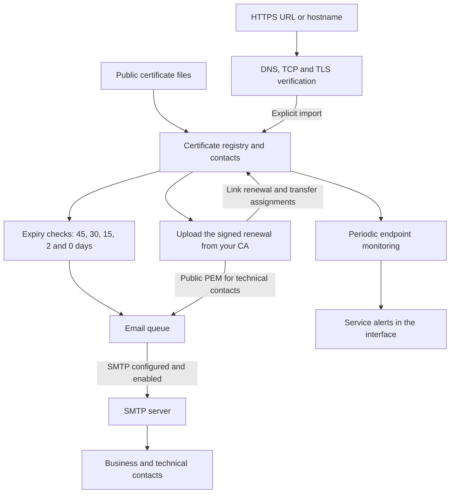

# Certificate Manager

A local HTTPS certificate registry written in C, with a multilingual web interface and a SQLite database. Import public X.509 certificates, track expiry dates, assign business and technical contacts, monitor HTTPS endpoints, and prepare renewal emails.

[GitHub repository](https://github.com/GiorgioOppo/Certificate-Manager)

[Guida completa in italiano](docs/README.it.md) · [Workflow](docs/WORKFLOW.md) · [Workflow in italiano](docs/WORKFLOW.it.md) · [Translations](docs/TRANSLATING.md) · [Contributing](CONTRIBUTING.md) · [Security](SECURITY.md) · [Publishing to GitHub](docs/PUBLISHING.md)

## Features

- Import PEM, CRT, CER and DER files, including PEM certificate bundles. Extract CN, SANs, issuer, validity dates, serial number, SHA-256 fingerprint, public key and signature algorithm.
- Reconstruct Root CA and intermediate CA chains from available certificates, verifying their links and signatures.
- Combine search with status, expiry within **45, 30, 15 or 2 days**, Root CA, intermediate CA, business contact and technical contact filters. Keep filters while navigating in the same browser tab.
- Assign multiple people to each contact role. Business contacts receive expiry reminders; technical contacts receive the signed public certificate and available chain after renewal.
- Record renewals, preserve contact assignments and monitoring targets, and retain superseded certificates in the registry.
- Inspect certificates from an HTTPS URL or resolvable hostname. Report DNS, TCP, TLS, trust, hostname and validity results before importing or downloading the received public chain.
- Periodically monitor up to 100 configured endpoints, detect unreachable services or changed certificates, and record recovery events.
- Configure SMTP in the interface, test TLS and authentication without sending messages, inspect `.eml` previews, and pause or enable delivery.
- Use the interface in **English, Italian, French, Spanish, Simplified Chinese or Japanese**.

This is a local application. The HTTP server binds to **127.0.0.1** by default; Docker Compose publishes it only on the host’s loopback address. It has no user authentication or access roles. Publishing the source on GitHub does not make it a hosted service. See [Security](SECURITY.md) before considering network exposure.

## Workflow



Import a public certificate, assign contacts, and associate the HTTPS endpoints to monitor. The backend stores data in SQLite, checks expiry dates, compares live certificates with the registry, and prepares messages. Business contacts receive expiry reminders; technical contacts receive the signed renewal and available chain, then install it on the service themselves. Monitoring alerts are shown in the interface and do not generate email.

The program must keep running for periodic checks and delivery. Without an enabled SMTP configuration, messages remain in the queue. See the [complete workflow](docs/WORKFLOW.md) or the [Italian explanation](docs/WORKFLOW.it.md) for component communication, timing, renewal steps and an operational example.

## Build and run

Requirements: a C11 compiler, Make, OpenSSL, SQLite **3.24 or newer**, libcurl with SMTP/TLS support, `pkg-config`, and Python 3. Tests also use the `openssl` command and Node.js for interface checks. Python embeds the interface into the executable; a compiled application does not need Python or external web files to run.

Clone the source and enter the project directory:

```sh
git clone https://github.com/GiorgioOppo/Certificate-Manager.git
cd Certificate-Manager
```

On Ubuntu/Debian:

```sh
sudo apt update
sudo apt install build-essential pkg-config libssl-dev libsqlite3-dev libcurl4-openssl-dev openssl python3 nodejs
make
./certificati
```

On macOS, install the Xcode command line tools and Homebrew, then:

```sh
brew install openssl sqlite pkg-config python3 node
make
./certificati
```

The build uses `pkg-config` for `openssl`, `sqlite3` and `libcurl`. If Homebrew's OpenSSL or SQLite is not found, add its package configuration directories:

```sh
PKG_CONFIG_PATH="$(brew --prefix openssl)/lib/pkgconfig:$(brew --prefix sqlite)/lib/pkgconfig${PKG_CONFIG_PATH:+:$PKG_CONFIG_PATH}" make
```

If `pkg-config --exists libcurl` fails, install Homebrew's curl and include it as well:

```sh
brew install curl
PKG_CONFIG_PATH="$(brew --prefix openssl)/lib/pkgconfig:$(brew --prefix sqlite)/lib/pkgconfig:$(brew --prefix curl)/lib/pkgconfig${PKG_CONFIG_PATH:+:$PKG_CONFIG_PATH}" make
```

Open [http://127.0.0.1:8080](http://127.0.0.1:8080). The default database is `certificati.db` in the current working directory. Press `Ctrl+C` in the terminal to stop the application.

To choose another database or port:

```sh
./certificati --db registry.db serve --port 8090
```

The database's parent directory must already exist. The executable and command names remain `certificati` for compatibility.

## Run with Docker Compose

Install Docker Engine with the [Compose plugin](https://docs.docker.com/compose/gettingstarted/), or Docker Desktop, then run these commands from the cloned project directory:

```sh
docker compose up --build -d
docker compose logs -f certificate-manager
```

Open [http://127.0.0.1:8080](http://127.0.0.1:8080). If the native application already occupies port 8080, start the container on another port:

```sh
CERTIFICATI_PORT=8081 docker compose up --build -d
```

Then open [http://127.0.0.1:8081](http://127.0.0.1:8081). Use the same `CERTIFICATI_PORT` value whenever rebuilding or recreating the service. Compose uses that port both inside the container and on the host so the interface’s Host/Origin checks remain consistent.

The multi-stage Dockerfile builds the executable and runs it as an unprivileged user (UID/GID `10001:10001`). The runtime root filesystem is read-only, with a temporary `/tmp` and persistent `/data`. The `certificate-data` named volume stores `/data/certificati.db` and its `.smtp.key` together. A first container starts with an empty registry: it does not automatically import the database used by the native application.

```sh
# Rebuild and apply source updates, keeping the existing data volume.
docker compose up --build -d

# Stop and remove the container and network, keeping its data volume.
docker compose down
```

Set `CERTIFICATI_PORT` on the update command as above if using a different port. `docker compose stop` also preserves data. **`docker compose down -v` deletes the volume and all registry data**; use it only when deliberately discarding the installation.

Configure SMTP from **Email queue** as usual. Inside the container, `localhost` refers to the container itself; use an SMTP hostname reachable from its network. For private CA files, add a read-only mount and the appropriate `CERTIFICATI_TLS_CA_FILE` or `CERTIFICATI_SMTP_CA_FILE` variable to the service; see [HTTPS checks](#https-checks-and-periodic-monitoring) and [SMTP configuration](#smtp-configuration).

The listener uses `0.0.0.0` inside the container so Docker can reach it, while Compose publishes the port on **127.0.0.1 only**. Keep this host binding: the interface still has no user authentication. See [Security](SECURITY.md).

### Back up container data

Stop the service before archiving its complete volume, including the database and SMTP encryption key:

```sh
docker compose stop certificate-manager
umask 077
docker compose run -T --rm --no-deps --entrypoint /bin/sh certificate-manager -c 'tar -C /data -czf - .' > certificate-manager-backup.tar.gz
docker compose start certificate-manager
```

Keep this archive private. When restoring it, preserve ownership `10001:10001` and mode `0600` on the `.smtp.key` file. Back up before upgrades; never add the archive to Git.

## Web pages and languages

| Page | Address | Purpose |
| --- | --- | --- |
| Overview | `/` | Counts, upcoming expiry dates and service alerts. |
| Certificates | `/certificati` | Registry, combined filters, contacts and renewals. |
| Monitored services | `/servizi` | Endpoint configuration, results and monitoring events. |
| Import certificates | `/importa` | Upload public PEM, DER, CRT and CER certificates. |
| Verify endpoint | `/verifica` | Retrieve and compare the certificate presented by a service. |
| Reminders | `/promemoria` | Expiry reminders and optional desktop notifications. |
| Email queue | `/email` | SMTP settings, delivery state and `.eml` downloads. |
| Workflow | `/workflow` | Component diagrams and explanations of acquisition, checks, renewal and delivery. |

Each page supports direct navigation, reload and browser history. Registry rows become readable cards on narrow screens. The Workflow page explains how the components communicate, with diagrams available locally in every interface language.

Select a language in the interface: English (`en`), Italiano (`it`), Français (`fr`), Español (`es`), 简体中文 (`zh-CN`) or 日本語 (`ja`). Dates and times follow the selected language. Language changes preserve registry filters; save or cancel form drafts first. Translations apply to interface text; certificate subjects, contact names and other user data retain their original content. The command-line interface and generated email message content remain in Italian.

## Expiry, contacts and renewals

Reminders are generated at **45, 30, 15 and 2 days before expiry**, plus expiry itself. Thresholds use exact 24-hour durations. If the application first sees a certificate with 10 days remaining, it creates the 15-day reminder and skips obsolete 45- and 30-day reminders. Recorded thresholds are not repeated after restarting.

Business contacts receive expiry emails. Technical contacts receive the renewed public certificate and available chain as a PEM attachment. Assign a person to both roles for both message types. Save contact changes in the certificate details before navigating away.

Obtain the signed renewal from your CA, then use the old certificate's renewal action. A renewal must already be valid, expire later than its predecessor, and preserve the same DNS/IP identities. The application transfers contacts and monitors, retains the old entry as superseded, and prepares emails for technical contacts. It **does not issue, sign or install certificates**.

The expiry filter includes certificates that are already valid and expire within the selected duration; it excludes expired and not-yet-valid certificates. Limits are cumulative and combine with all other filters. “Valid from” represents X.509 `notBefore`, which is not necessarily the actual signing time.

## HTTPS checks and periodic monitoring

Enter an HTTPS URL, hostname, `host:port`, IPv4 address, or bracketed IPv6 address in endpoint verification. The default port is 443. Replace wildcard CNs such as `*.example.test` with a real resolvable hostname.

Verification resolves DNS, connects with TCP and negotiates TLS. It **does not request an HTTP page**; URL paths and query content are not downloaded. Certificate data remains available for diagnosis when TLS permits it, even if trust, hostname or validity checks fail. A network failure does not mean a certificate is expired.

Inspect or download the result before explicitly adding it to the registry. The public acquisition is held in memory for 10 minutes, with at most eight recent acquisitions. Importing from an online check automatically prepares a 15-minute monitor for the same endpoint. Manual imports do not create monitors.

Monitoring intervals range from 1 to 1440 minutes. Checks continue while `serve` or `watch` runs, even when the browser is closed. Repeated identical failures are deduplicated; certificate changes and recovery are recorded. Monitor events appear in the interface and optional desktop notifications; they **do not enter the email queue**.

OpenSSL's process trust configuration is used for HTTPS checks. An optional `CERTIFICATI_TLS_CA_FILE` can provide a PEM CA file for a private network. Importing a Root CA into the registry does not make it trusted. Revocation checking and AIA issuer retrieval are not implemented.

## SMTP configuration

In **Email queue**, open SMTP configuration, enter host, port, sender and optional credentials, then save. Supported transports are mandatory **STARTTLS** and **implicit TLS**; there is no plaintext delivery mode. Certificates and hostnames are verified, with TLS 1.2 or newer required.

“Test connection” checks the current draft's TLS connection and authentication without saving or sending email. “Enable automatic delivery” controls whether saved settings may process the queue. With delivery disabled, messages remain available for review and `.eml` download.

Passwords are not returned by the API or prefilled in the browser. Leaving the field empty preserves a saved password only when host, port, security mode and username are unchanged. Saved passwords use AES-256-GCM encryption; the local key is stored in `<database>.smtp.key` with mode `0600`. Protect and back up **both** the database and key. Anyone able to read both can recover the password.

Environment configuration is available when no SMTP profile has been saved in the database. A saved disabled profile also takes precedence, so pausing delivery is respected.

| Variable | Purpose |
| --- | --- |
| `CERTIFICATI_SMTP_URL` | `smtp://host:587` or `smtps://host:465`, without credentials in the URL. |
| `CERTIFICATI_SMTP_FROM` | Sender email address. |
| `CERTIFICATI_SMTP_USERNAME` | Optional authentication username. |
| `CERTIFICATI_SMTP_PASSWORD` | Corresponding password; configure it with the username. |
| `CERTIFICATI_SMTP_CA_FILE` | Optional PEM trust file for SMTP; separate from HTTPS endpoint trust. |

The queue runs every 60 seconds while the server is active, from the process-queue button, or through `check` and `watch`. Failed deliveries use increasing delays, up to five automatic attempts. “Sent” means the SMTP server accepted the message, not that it reached the inbox. An interruption after SMTP acceptance can result in a duplicate.

## Command line

```sh
./certificati import service.pem other.der chain.pem
./certificati list
./certificati show 1
./certificati check
./certificati watch --interval 60
./certificati remove 1
./certificati help
```

Place `--db PATH` before the command. `watch` checks expiry, delivery and configured URLs without serving the interface. Its interval controls expiry and email processing; URL monitors retain their own intervals. The program must remain running to perform scheduled work.

## Data and backups

The database contains public certificates, metadata, contact details, reminders, monitor history, the email queue and SMTP settings. It never stores TLS private keys. Uploads reject private keys, PKCS#12/PFX files and unrelated data; the per-file limit is 16 MiB. Duplicates are identified by SHA-256 fingerprint. Existing databases are migrated automatically to schema version 4.

Stop every application process using a database before copying it. Back up its `.smtp.key` sidecar if present, keep both files private, and make a backup before upgrading. Do not commit databases, SMTP keys, environment files or real service credentials. The repository ignores these artifacts; tests create temporary certificates and databases instead of using production material.

## Development and tests

```sh
make test
```

The suite covers certificate parsing, chain reconstruction, reminders, role assignments, renewals, queue behavior, encrypted SMTP settings, migrations, HTTP/CSRF checks, the eight web pages, endpoint verification and background monitoring. Network tests use local TLS/SMTP peers and temporary certificates; they do not require a real SMTP account or contact public HTTPS sites. Node.js is used for interface checks.

The [GitHub Actions workflow](.github/workflows/ci.yml) builds and tests on Ubuntu on each push and pull request. It uses the official [checkout](https://github.com/actions/checkout) and [setup-node](https://github.com/actions/setup-node) actions. See [Contributing](CONTRIBUTING.md) for source layout and [Publishing to GitHub](docs/PUBLISHING.md) for publication steps.

## License

[MIT](LICENSE), copyright © 2026 Certificate Manager contributors.
