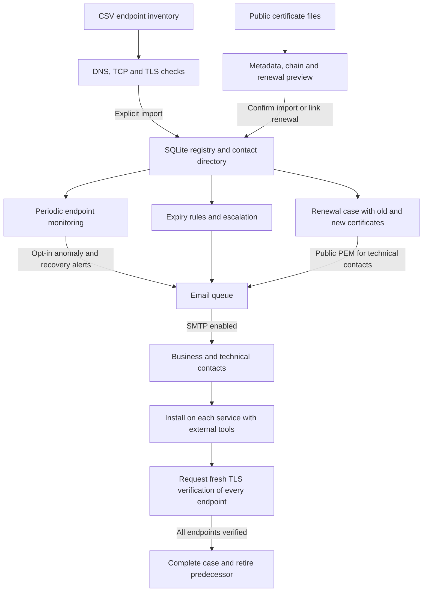

# Certificate Manager

A local HTTPS certificate registry written in C, with a multilingual web interface and a SQLite database. Import public X.509 certificates, track expiry dates, assign business and technical contacts, monitor HTTPS endpoints, and prepare renewal emails.

[GitHub repository](https://github.com/GiorgioOppo/Certificate-Manager)

[Guida completa in italiano](docs/README.it.md) · [Workflow](docs/WORKFLOW.md) · [Workflow in italiano](docs/WORKFLOW.it.md) · [Translations](docs/TRANSLATING.md) · [Contributing](CONTRIBUTING.md) · [Security](SECURITY.md) · [Publishing to GitHub](docs/PUBLISHING.md)

## Features

- Preview PEM, CRT, CER and DER imports, including bundles: inspect CN, SANs, issuer, validity, fingerprints, duplicates and possible renewals before saving.
- Import an inventory of up to 100 HTTPS endpoints and their contacts from CSV, with URL checks and explicit import of the retrieved certificates.
- Reconstruct Root CA and intermediate CA chains, highlight missing issuers and add the available CA files to complete the registry.
- Combine text search with status, expiry within **45, 30, 15 or 2 days**, Root CA, intermediate CA and both contact-role filters.
- Maintain a central directory of people and groups; assign them to multiple certificates as business or technical contacts and propagate directory changes.
- Plan request, renewal and installation dates with a responsible person and notes, independently of X.509 validity dates.
- Track renewal cases from request to verified installation. Keep multiple valid certificates for the same CN, identified by SHA-256 fingerprint, throughout deployment.
- Configure reminder thresholds per certificate, retaining 45/30/15/2 days and expiry as defaults, and optionally escalate to another recipient after the first reminder.
- Inspect live certificates from HTTPS URLs or hostnames and monitor up to 100 endpoints. Opt into email alerts for service anomalies and recovery, with event deduplication.
- Distribute the signed public certificate and available chain to technical contacts, then verify installation separately for each endpoint before retiring the predecessor.
- Configure SMTP in the interface, test TLS and authentication without sending messages, inspect `.eml` previews, and pause or enable delivery.
- Use nine web pages in **English, Italian, French, Spanish, Simplified Chinese or Japanese**.

This is a local application. The HTTP server binds to **127.0.0.1** by default; Docker Compose publishes it only on the host’s loopback address. It has no user authentication or access roles. Publishing the source on GitHub does not make it a hosted service. See [Security](SECURITY.md) before considering network exposure.

## Workflow



Import a public certificate, assign people or groups, and associate the endpoints to monitor. A signed renewal is linked to its predecessor while both remain active; monitors stay associated with the predecessor until verified completion. During the transition, the previous certificate and explicitly approved replacements are recognized, with TLS verification still required. Business contacts receive expiry reminders; technical contacts receive the signed renewal and install it externally. Optional monitor email alerts use the same queue.

The program must keep running for periodic checks and delivery. Without an enabled SMTP configuration, messages remain queued. See the [complete workflow](docs/WORKFLOW.md) or the [Italian explanation](docs/WORKFLOW.it.md) for timing, component communication and an example with staggered deployment.

## Build and run

Requirements: a C11 compiler, Make, OpenSSL, SQLite **3.24 or newer**, libcurl with SMTP/TLS support, `pkg-config`, and Python 3. Tests also use the `openssl` command and Node.js for interface checks. Python embeds the interface into the executable; a compiled application does not need Python or external web files to run.

Clone the source and enter the project directory:

```sh
git clone https://github.com/GiorgioOppo/Certificate-Manager.git
cd Certificate-Manager
```

On Ubuntu/Debian:

```sh
sudo apt update
sudo apt install build-essential pkg-config libssl-dev libsqlite3-dev libcurl4-openssl-dev openssl python3 nodejs
make
./certificati
```

On macOS, install the Xcode command line tools and Homebrew, then:

```sh
brew install openssl sqlite pkg-config python3 node
make
./certificati
```

The build uses `pkg-config` for `openssl`, `sqlite3` and `libcurl`. If Homebrew's OpenSSL or SQLite is not found, add its package configuration directories:

```sh
PKG_CONFIG_PATH="$(brew --prefix openssl)/lib/pkgconfig:$(brew --prefix sqlite)/lib/pkgconfig${PKG_CONFIG_PATH:+:$PKG_CONFIG_PATH}" make
```

If `pkg-config --exists libcurl` fails, install Homebrew's curl and include it as well:

```sh
brew install curl
PKG_CONFIG_PATH="$(brew --prefix openssl)/lib/pkgconfig:$(brew --prefix sqlite)/lib/pkgconfig:$(brew --prefix curl)/lib/pkgconfig${PKG_CONFIG_PATH:+:$PKG_CONFIG_PATH}" make
```

Open [http://127.0.0.1:8080](http://127.0.0.1:8080). The default database is `certificati.db` in the current working directory. Press `Ctrl+C` in the terminal to stop the application.

To choose another database or port:

```sh
./certificati --db registry.db serve --port 8090
```

The database's parent directory must already exist. The executable and command names remain `certificati` for compatibility.

## Run with Docker Compose

Install Docker Engine with the [Compose plugin](https://docs.docker.com/compose/gettingstarted/), or Docker Desktop, then run these commands from the cloned project directory:

```sh
docker compose up --build -d
docker compose logs -f certificate-manager
```

Open [http://127.0.0.1:8080](http://127.0.0.1:8080). If the native application already occupies port 8080, start the container on another port:

```sh
CERTIFICATI_PORT=8081 docker compose up --build -d
```

Then open [http://127.0.0.1:8081](http://127.0.0.1:8081). Use the same `CERTIFICATI_PORT` value whenever rebuilding or recreating the service. Compose uses that port both inside the container and on the host so the interface’s Host/Origin checks remain consistent.

The multi-stage Dockerfile builds the executable and runs it as an unprivileged user (UID/GID `10001:10001`). The runtime root filesystem is read-only, with a temporary `/tmp` and persistent `/data`. The `certificate-data` named volume stores `/data/certificati.db` and its `.smtp.key` together. A first container starts with an empty registry: it does not automatically import the database used by the native application.

```sh
# Rebuild and apply source updates, keeping the existing data volume.
docker compose up --build -d

# Stop and remove the container and network, keeping its data volume.
docker compose down
```

Set `CERTIFICATI_PORT` on the update command as above if using a different port. `docker compose stop` also preserves data. **`docker compose down -v` deletes the volume and all registry data**; use it only when deliberately discarding the installation.

Configure SMTP from **Email queue** as usual. Inside the container, `localhost` refers to the container itself; use an SMTP hostname reachable from its network. For private CA files, add a read-only mount and the appropriate `CERTIFICATI_TLS_CA_FILE` or `CERTIFICATI_SMTP_CA_FILE` variable to the service; see [HTTPS checks](#https-checks-and-periodic-monitoring) and [SMTP configuration](#smtp-configuration).

The listener uses `0.0.0.0` inside the container so Docker can reach it, while Compose publishes the port on **127.0.0.1 only**. Keep this host binding: the interface still has no user authentication. See [Security](SECURITY.md).

### Back up container data

Stop the service before archiving its complete volume, including the database and SMTP encryption key:

```sh
docker compose stop certificate-manager
umask 077
docker compose run -T --rm --no-deps --entrypoint /bin/sh certificate-manager -c 'tar -C /data -czf - .' > certificate-manager-backup.tar.gz
docker compose start certificate-manager
```

Keep this archive private. When restoring it, preserve ownership `10001:10001` and mode `0600` on the `.smtp.key` file. Back up before upgrades; never add the archive to Git.

## Web pages and languages

| Page | Address | Purpose |
| --- | --- | --- |
| Overview | `/` | Counts, upcoming expiry dates and service alerts. |
| Certificates | `/certificati` | Registry, combined filters, contacts and renewals. |
| Monitored services | `/servizi` | Endpoint configuration, results and monitoring events. |
| Import certificates | `/importa` | Preview certificate files or check and import a CSV endpoint inventory. |
| Verify endpoint | `/verifica` | Retrieve and compare the certificate presented by a service. |
| Reminders | `/promemoria` | Expiry reminders and optional desktop notifications. |
| Email queue | `/email` | SMTP settings, delivery state and `.eml` downloads. |
| Workflow | `/workflow` | Component diagrams and explanations of acquisition, checks, renewal and delivery. |
| Directory | `/rubrica` | Reusable people, groups and shared contact assignments. |

Each page supports direct navigation, reload and browser history. Registry rows become readable cards on narrow screens. The Workflow page explains how the components communicate, with diagrams available locally in every interface language.

Select a language in the interface: English (`en`), Italiano (`it`), Français (`fr`), Español (`es`), 简体中文 (`zh-CN`) or 日本語 (`ja`). Dates and times follow the selected language. Language changes preserve registry filters; save or cancel form drafts first. Translations apply to interface text; certificate subjects, contact names and other user data retain their original content. The command-line interface and generated email message content remain in Italian.

## Guided imports and CSV inventory

Select certificate files in **Import certificates** to review extracted dates, CA information, fingerprints and duplicates before saving. The preview proposes existing certificates with compatible DNS/IP identities and an earlier expiry as possible predecessors. Confirm a renewal link explicitly; a shared CN alone does not establish one. Incomplete-chain warnings show which issuer information is missing so available CA certificates can be added. There is no automatic issuer download.

The same page accepts a CSV file (up to 1 MiB) or pasted CSV text, with at most **100 data rows**. `url` is required; the contact columns are optional:

```csv
url,business_name,business_email,technical_name,technical_email
https://service.example.test,Service owner,owner@example.test,Operations,ops@example.test
```

Separate multiple names and email addresses within a contact cell using semicolons, in matching order. Standard CSV quoting is supported. Validate the inventory, check its URLs, inspect results and then choose the import action. The browser processes rows sequentially and must remain open. Each import refreshes the certificate acquisition and rejects an unexpected fingerprint change since the preview. Successful rows are retained if another row fails; correct the reported error and retry. Existing assignments are merged by role and email.

## Expiry, contacts and renewals

Default reminders are **45, 30, 15 and 2 days before expiry**, plus expiry itself. A certificate's details can instead define distinct thresholds from **0 to 3650 days**, including `0`, or pause its reminder policy. Thresholds use exact 24-hour durations. With the defaults, a first check at 10 days remaining records the 15-day reminder and skips obsolete 45- and 30-day reminders. Recorded thresholds are not repeated after restarting.

Optionally configure an escalation recipient and a delay of **0 to 365 days from the first recorded reminder**. Escalation is deduplicated per certificate and recipient while the certificate remains active. Loading a renewal does not stop the predecessor's reminders or escalation; verified completion or explicit retirement does.

Business contacts receive expiry emails; technical contacts receive the signed public certificate and available chain as a PEM attachment. Assign a person to both roles for both message types. **Directory** (`/rubrica`) stores reusable people and groups. Assignments can cover several certificates; updating a directory email or group membership propagates to those assignments. Removing a recipient cancels their relevant pending or failed messages, preserving sent history.

A certificate's renewal case records request, planned renewal and planned installation dates, a responsible person and notes. These operational dates do not modify `notBefore` or `notAfter`. Case stages are **Requested → Awaiting CA → Signed → Delivered → Installing → Verified**; the workflow also has a distinct **Retired** outcome for explicit manual retirement. Advancing a descriptive stage does not issue a certificate, send an email or prove installation.

Obtain the signed renewal from your CA, then upload it through the predecessor's renewal action or link a compatible certificate already in the registry. It must already be valid, expire later and preserve the same DNS/IP identities; CN is a fallback when DNS/IP SANs are absent. Contacts, group assignments and any reminder policy are copied. A matching open case without a replacement is reused, and public PEM messages are prepared for technical contacts. The application **does not issue, sign or install certificates**.

**Multiple certificates for the same CN can remain valid together.** Their SHA-256 fingerprints identify separate records. Loading or linking a renewal keeps the predecessor active, preserves its queued reminders and leaves its monitors in place. Operational labels **In use**, **Ready**, **Deploying** and **Retired** are independent of X.509 time validity.

After installation, request verification for one endpoint or all endpoints from the renewal case. An earlier automatic observation cannot substitute for this request. Completion requires every associated endpoint to present the new fingerprint with successful TLS verification after the request, with both request and result within the last **15 minutes**. Paused endpoints must be reactivated. Only completion transfers the verified monitors and archives a predecessor with no remaining monitor associations. If there are no endpoints, verified completion is unavailable: manual retirement requires a responsible person, an explicit note and no remaining monitor associations, and records **Retired**, not **Verified**.

The expiry filter includes certificates that are already valid and expire within the selected duration; it excludes expired and not-yet-valid certificates. Limits are cumulative and combine with all other filters. “Valid from” represents X.509 `notBefore`, which is not necessarily the actual signing time.

## HTTPS checks and periodic monitoring

Enter an HTTPS URL, hostname, `host:port`, IPv4 address, or bracketed IPv6 address in endpoint verification. The default port is 443. Replace wildcard CNs such as `*.example.test` with a real resolvable hostname.

Verification resolves DNS, connects with TCP and negotiates TLS. It **does not request an HTTP page**; URL paths and query content are not downloaded. Certificate data remains available for diagnosis when TLS permits it, even if trust, hostname or validity checks fail. A network failure does not mean a certificate is expired.

Inspect or download the result before explicitly adding it to the registry. The public acquisition is held in memory for 10 minutes, with at most eight recent acquisitions. Importing from an online check automatically prepares a 15-minute monitor for the same endpoint. Manual imports do not create monitors.

Monitoring intervals range from 1 to 1440 minutes. Checks continue while `serve` or `watch` runs, even when the browser is closed. Repeated identical failures are deduplicated; certificate changes and recovery are recorded. Enable email alerts and select recipients per monitor to queue new anomaly and recovery events. Alerts are off by default; enabling them does not replay old events. Interface events and optional desktop notifications remain available.

During renewal, a monitor recognizes the original fingerprint and valid replacements explicitly linked in a signed, delivered or installing case. All still require successful TLS trust, hostname and validity checks. An unrelated certificate remains an unexpected change; monitoring never approves or imports it automatically.

OpenSSL's process trust configuration is used for HTTPS checks. An optional `CERTIFICATI_TLS_CA_FILE` can provide a PEM CA file for a private network. Importing a Root CA into the registry does not make it trusted. Revocation checking and AIA issuer retrieval are not implemented.

## SMTP configuration

In **Email queue**, open SMTP configuration, enter host, port, sender and optional credentials, then save. Supported transports are mandatory **STARTTLS** and **implicit TLS**; there is no plaintext delivery mode. Certificates and hostnames are verified, with TLS 1.2 or newer required.

“Test connection” checks the current draft's TLS connection and authentication without saving or sending email. “Enable automatic delivery” controls whether saved settings may process the queue. With delivery disabled, messages remain available for review and `.eml` download.

Passwords are not returned by the API or prefilled in the browser. Leaving the field empty preserves a saved password only when host, port, security mode and username are unchanged. Saved passwords use AES-256-GCM encryption; the local key is stored in `<database>.smtp.key` with mode `0600`. Protect and back up **both** the database and key. Anyone able to read both can recover the password.

Environment configuration is available when no SMTP profile has been saved in the database. A saved disabled profile also takes precedence, so pausing delivery is respected.

| Variable | Purpose |
| --- | --- |
| `CERTIFICATI_SMTP_URL` | `smtp://host:587` or `smtps://host:465`, without credentials in the URL. |
| `CERTIFICATI_SMTP_FROM` | Sender email address. |
| `CERTIFICATI_SMTP_USERNAME` | Optional authentication username. |
| `CERTIFICATI_SMTP_PASSWORD` | Corresponding password; configure it with the username. |
| `CERTIFICATI_SMTP_CA_FILE` | Optional PEM trust file for SMTP; separate from HTTPS endpoint trust. |

The queue runs every 60 seconds while the server is active, from the process-queue button, or through `check` and `watch`. Failed deliveries use increasing delays, up to five automatic attempts. “Sent” means the SMTP server accepted the message, not that it reached the inbox. An interruption after SMTP acceptance can result in a duplicate.

## Command line

```sh
./certificati import service.pem other.der chain.pem
./certificati list
./certificati show 1
./certificati check
./certificati watch --interval 60
./certificati remove 1
./certificati help
```

Place `--db PATH` before the command. `watch` checks expiry, delivery and configured URLs without serving the interface. Its interval controls expiry and email processing; URL monitors retain their own intervals. The program must remain running to perform scheduled work.

## Data and backups

The database contains public certificates, metadata, contact details, reminders, monitor history, the email queue and SMTP settings. It never stores TLS private keys. Uploads reject private keys, PKCS#12/PFX files and unrelated data; the per-file limit is 16 MiB. Duplicates are identified by SHA-256 fingerprint. Existing databases are migrated automatically to schema version **5**, adding renewal cases, endpoint verification records, the directory, reminder policies and monitor email recipients. Previously archived renewal history remains archived and is recorded as manual/historical retirement rather than claiming verified installation.

Stop every application process using a database before copying it. Back up its `.smtp.key` sidecar if present, keep both files private, and make a backup before upgrading. Do not commit databases, SMTP keys, environment files or real service credentials. The repository ignores these artifacts; tests create temporary certificates and databases instead of using production material.

## Development and tests

```sh
make test
```

The suite covers certificate parsing, chain reconstruction, reminders, directory/group propagation, custom reminder and escalation policies, overlapping renewals, fresh endpoint verification, monitor email alerts, queue behavior, encrypted SMTP settings, migrations, HTTP/CSRF checks, the nine web pages, endpoint verification and background monitoring. Network tests use local TLS/SMTP peers and temporary certificates; they do not require a real SMTP account or contact public HTTPS sites. Node.js is used for interface checks.

The [GitHub Actions workflow](.github/workflows/ci.yml) builds and tests on Ubuntu on each push and pull request. It uses the official [checkout](https://github.com/actions/checkout) and [setup-node](https://github.com/actions/setup-node) actions. See [Contributing](CONTRIBUTING.md) for source layout and [Publishing to GitHub](docs/PUBLISHING.md) for publication steps.

## License

[MIT](LICENSE), copyright © 2026 Certificate Manager contributors.
