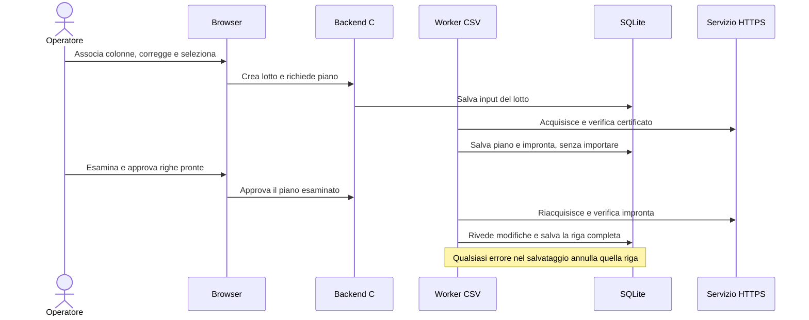

# I 20 miglioramenti dei flussi

[Guida italiana](README.it.md) · [Workflow con diagrammi](WORKFLOW.it.md) · [English workflow](WORKFLOW.md)

Questa guida descrive le funzioni disponibili e come provarle con dati dimostrativi. I numeri corrispondono alle venti proposte originali; non rappresentano una priorità d’esecuzione. Per una prova di rinnovo usa due certificati pubblici validi con le stesse identità DNS/IP, impronte distinte e scadenza successiva per il nuovo. La sola uguaglianza del CN non basta quando sono presenti SAN DNS/IP.

## Importazione: preparare, rivedere e salvare

| # | Funzione | Percorso e prova pratica |
| --- | --- | --- |
| 1 | Mappatura guidata del CSV | In **Importa**, scegli virgola, punto e virgola o tabulazione e associa ogni colonna al campo previsto, oppure ignorala. Prova un’intestazione `Hostname`: non viene interpretata implicitamente come `url`; serve l’associazione esplicita. |
| 2 | Correzione nella preview | **Valida CSV** mostra numeri di riga e errori per campo. Apri la modifica della riga, correggi l’email e salva: quella riga viene rivalidata e il precedente piano viene invalidato. Puoi scaricare il contenuto corretto. |
| 3 | Importazione delle righe selezionate | Se una riga è errata, seleziona le sole valide prima di verificare gli URL. Nel riepilogo del lotto approva esplicitamente le righe pronte; quelle non approvate non vengono importate. |
| 4 | Report delle importazioni | Scarica gli esiti della preview o apri un lotto salvato per report completo e CSV delle righe ancora da correggere. Il report completo mantiene linea, contenuto, stato, ID certificato ed errore; il CSV da correggere usa le intestazioni di importazione. |
| 5 | Lotti persistenti e riprendibili | **Verifica URL** conserva un lotto e ne prepara il piano sul server. Dopo l’approvazione puoi chiudere il browser: il worker prosegue, se `serve` o `watch` resta attivo. Dopo il riavvio riapri il lotto per controllare esiti, mettere in pausa o ripianificare le righe rimaste. |
| 6 | Salvataggio completo per riga | La stessa transazione comprende catena del certificato, monitor, persone, assegnazioni per ruolo, audit e ricevuta contro i duplicati. Se una parte fallisce, la riga non lascia nuovi salvataggi parziali; le righe già riuscite restano. |
| 7 | Riepilogo delle modifiche | Prima di approvare esamina nuovo/già presente, monitor, CA, date, nomi ed email aggiunti/conservati/in conflitto. Un nome diverso per la stessa email richiede di scegliere **mantieni** o **aggiorna**. L’impronta online e il piano vengono ricontrollati prima del salvataggio; cambiamenti incompatibili richiedono una nuova revisione. |

Il file può contenere al massimo 100 righe di dati ed essere grande fino a 1 MiB. I cinque campi sono `url`, `business_name`, `business_email`, `technical_name` e `technical_email`; soltanto `url` è obbligatorio. Nella stessa cella separa destinatari multipli con punto e virgola, rispettando l’ordine dei nomi. Se il separatore del file è anch’esso punto e virgola, racchiudi tali celle fra virgolette CSV. La creazione del piano non autorizza l’importazione. Il worker CSV non elabora la coda email.

## Rubrica, agenda e passaggio al nuovo certificato

| # | Funzione | Percorso e prova pratica |
| --- | --- | --- |
| 8 | Impatto sulla rubrica | Prima di salvare una persona/gruppo esistente, il riepilogo mostra dati e appartenenze prima/dopo, certificati coinvolti e messaggi pendenti; per l’eliminazione mostra i collegamenti attuali. Aggiungi una persona a un gruppo assegnato a un altro certificato e verifica che anche quel certificato compaia nell’impatto proposto. |
| 9 | Agenda operativa | **Rinnovi** (`/rinnovi`) raccoglie le pratiche e filtra fase, responsabile e sole pratiche in ritardo. Una data prevista d’installazione passata fa comparire il ritardo anche se il certificato è ancora valido. |
| 10 | Tutte le pratiche visibili | Nel dettaglio del certificato scegli la pratica dall’elenco di casi aperti e conclusi. Due rinnovi del medesimo precedente conservano distinti sostituto, consegne e prove. |
| 11 | Confronto precedente/rinnovo | Il confronto mostra CN, SAN, emittente, Root/intermedie, date, impronte e algoritmi, evidenziando differenze e compatibilità. Due certificati con CN uguale ma SAN incompatibili rimangono distinti e non possono diventare un rinnovo valido soltanto per il nome. |
| 12 | Checklist prima della chiusura | La pratica mostra impronta attesa/osservata, ultimo controllo e motivi di blocco per ciascun servizio. Richiedi la verifica dopo l’installazione: un endpoint sul precedente, TLS non verificato o prove oltre 900 secondi impediscono la chiusura. La checklist e **Completa pratica** usano la stessa funzione del server. |
| 13 | Gestione guidata del certificato cambiato | Dal dettaglio di un evento con impronta inattesa apri **Acquisisci e confronta**, ripeti la verifica online e consulta il risultato rispetto al certificato atteso. L’importazione e l’eventuale collegamento di rinnovo restano azioni esplicite. |

Caricare o collegare un rinnovo mantiene attivi il precedente, i suoi monitor e i promemoria. I tecnici installano il nuovo certificato esternamente; un servizio può usare il nuovo mentre un altro espone ancora il precedente valido. Ogni chiusura richiede la prova del sostituto della pratica specifica. Aggiornare la checklist legge le prove, senza avviare da solo un controllo TLS. Se manca un endpoint o è in pausa, la checklist lo segnala e la chiusura resta bloccata.

La chiusura verificata trasferisce i monitor nella stessa transazione e archivia il precedente soltanto senza altre associazioni. Con zero endpoint non si dichiara un’installazione verificata: il ritiro manuale richiede responsabile, nota e nessun monitor ancora associato, compresi quelli in pausa.

## Regole, anomalie e consegne

| # | Funzione | Percorso e prova pratica |
| --- | --- | --- |
| 14 | Simulazione dei promemoria | Nel dettaglio della regola usa **Simula** prima di salvare. Vedi calendario previsto/effettivo, soglie registrate, superate, future o immediate, referenti ed escalation; nessuna notifica o email viene creata dalla simulazione. |
| 15 | Modelli riutilizzabili | In **Promemoria** salva un modello, seleziona certificati attivi ed eccezioni, genera l’anteprima prima/dopo e applica. Se nel frattempo cambia un dato del piano, il backend richiede una nuova anteprima. Le eccezioni restano escluse. |
| 16 | Presa in carico delle anomalie | In **Servizi monitorati** scegli un evento, assegna responsabile, nota, termine e stato aperto/in analisi/risolto. Anche se lo segni risolto, un servizio ancora irraggiungibile mantiene il proprio esito tecnico. |
| 17 | Finestre di manutenzione | Sul monitor imposta inizio, fine e motivo. I controlli e gli eventi continuano, mentre i nuovi avvisi email di anomalia/ripristino sono sospesi nella finestra. Alla fine viene richiesto un controllo fresco; se il guasto persiste, può essere avvisato. Un monitor in pausa richiede comunque la riattivazione. |
| 18 | Conferma dei guasti transitori | Imposta da 1 a 10 errori di raggiungibilità consecutivi prima dell’email; il valore predefinito è uno. Con soglia tre, un singolo errore DNS/TCP resta visibile ma non prepara un avviso. TLS fallito o certificato inatteso non attendono la soglia di raggiungibilità. |
| 19 | Consegne nella pratica | Il pannello dei tecnici mostra destinatario, stato, tentativi, errore e accettazione SMTP; scarica `.eml` e ritenta i soli messaggi non riusciti. SMTP accettato non dimostra ricezione, lettura o installazione. |
| 20 | Cronologia e verbale di chiusura | **Workflow** permette di caricare le ultime 500 operazioni locali. Dalla pratica scarica il report JSON: separa dati correnti e prove catturate nella transazione di chiusura, prima del trasferimento monitor o ritiro. Un controllo successivo non riscrive quelle prove. |

## Limiti operativi e aggiornamento

- `serve` offre interfaccia e worker; `watch` mantiene l’elaborazione periodica senza HTTP. Se il processo è fermo, non vengono eseguiti controlli o invii. I lotti conservano il lavoro nel database, mentre i moduli non salvati restano bozze del browser.
- Le verifiche controllano DNS, TCP e TLS, senza richiedere pagine HTTP. La fiducia dipende dalle CA di OpenSSL ed eventualmente da `CERTIFICATI_TLS_CA_FILE`; importare una CA nel registro non la rende fidata per la rete.
- L’applicazione non richiede né firma certificati alla CA e non li installa sui servizi. Conserva soltanto certificati pubblici e metadati, senza chiavi private TLS.
- Senza SMTP configurato e abilitato i messaggi restano in coda. L’accettazione SMTP non è una conferma del destinatario; un’interruzione dopo l’accettazione può provocare un duplicato.
- L’audit descrive operazioni locali senza utenti autenticati. Responsabile e note sono dati dichiarati dall’operatore, non identità verificate. Database e verbali non hanno protezione antimanomissione. L’eliminazione di una pratica può eliminare il relativo verbale; il report esportato rimane una copia indipendente.
- Lo schema **v6** aggiunge lotti/ricevute CSV, modelli di regole, anomalie/manutenzioni, verbali e audit, conservando i dati precedenti. L’audit inizia dalla migrazione; non ricostruisce azioni passate. Prima di aggiornare arresta i processi e conserva database e chiave `<archivio>.smtp.key`, se presente, in un backup privato. La chiave deve mantenere i permessi `0600`.

## Verifiche automatiche nel progetto

La suite usa certificati, database e servizi TLS/SMTP locali temporanei. I casi riproducibili sono in:

- [`tests/test_inventory.cjs`](../tests/test_inventory.cjs): validazione CSV, separatori/mappatura e letture concorrenti dei file.
- [`tests/inventory_integration.py`](../tests/inventory_integration.py): piano senza importazione, riga completa, rollback, idempotenza, conflitti nomi/impronta/registro, selezione parziale, lotti e riavvio.
- [`tests/operations_integration.py`](../tests/operations_integration.py): impatto rubrica proposto, simulazione, modelli con eccezioni, confronti, checklist, consegne e prove di chiusura.
- [`tests/test_lifecycle.c`](../tests/test_lifecycle.c) e [`tests/lifecycle_integration.py`](../tests/lifecycle_integration.py): rinnovi sovrapposti e condizioni di verifica/chiusura.
- [`tests/test_incidents.c`](../tests/test_incidents.c) e [`tests/incidents_integration.py`](../tests/incidents_integration.py): soglie consecutive, manutenzione e presa in carico senza alterare gli esiti tecnici.
- [`tests/ui_pages.py`](../tests/ui_pages.py), [`tests/test_i18n.cjs`](../tests/test_i18n.cjs) e [`tests/i18n_integration.py`](../tests/i18n_integration.py): dieci pagine, asset e sei lingue.

Esegui `make test` dalla radice del progetto. Le prove nella tabella sono percorsi manuali di accettazione; per l’esito dell’esecuzione effettiva consulta il risultato della suite e i controlli della build corrente.
