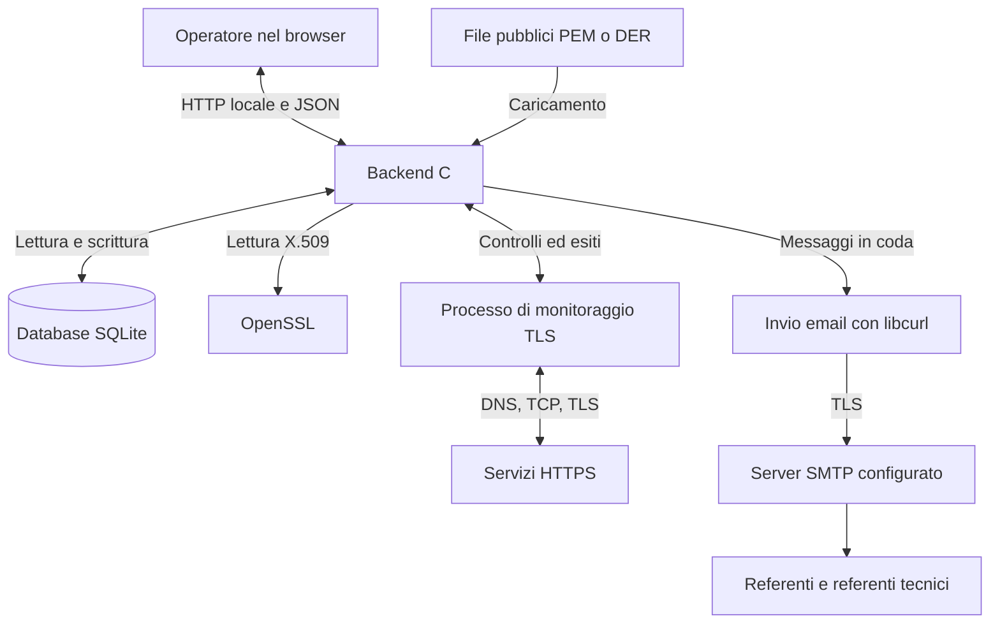
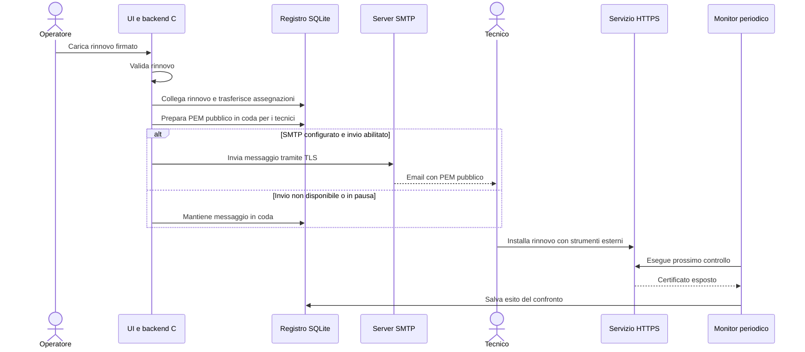

# Workflow di Certificate Manager

[Panoramica del progetto](../README.md) · [Guida italiana](README.it.md) · [English version](WORKFLOW.md)

Certificate Manager segue il certificato dall'acquisizione al rinnovo e controlla che i servizi monitorati espongano quello previsto nel registro. La CA fornisce il rinnovo firmato; il programma lo registra e ne distribuisce il materiale pubblico; i referenti tecnici lo installano sul servizio.

L’interfaccia web comprende anche la pagina **Workflow**, all’indirizzo `/workflow`, con i diagrammi dei componenti, del ciclo operativo e del rinnovo in tutte e sei le lingue. I diagrammi sono inclusi nell’eseguibile e funzionano senza caricare un servizio esterno.

## Come dialogano i componenti

Il browser offre le otto pagine e chiama il backend su `127.0.0.1`. Il backend gestisce validazione, operazioni sui certificati, controlli pianificati e salvataggio dei dati. Gli aggiornamenti della pagina leggono lo stato salvato; chiudere il browser non ferma i controlli del backend. Le acquisizioni di rete dei monitor avvengono in un processo separato, così un servizio TLS lento non occupa il gestore delle richieste web.

| Parte | Responsabilità | Sorgente |
| --- | --- | --- |
| Interfaccia web | Moduli, filtri del registro, risultati e scelta della lingua; aggiorna lo stato ogni 30 secondi. | [`web/app.js`](../web/app.js), [`web/i18n.js`](../web/i18n.js) |
| Server HTTP | Pubblica pagine e API; controlla Host, Origin e token CSRF dove richiesto. | [`src/server.c`](../src/server.c) |
| Gestione certificati | Importazione, scadenze, modifica dei referenti e rinnovo. OpenSSL estrae i dati X.509 e ricostruisce la catena disponibile. | [`src/app.c`](../src/app.c), [`src/certificate.c`](../src/certificate.c), [`src/chain.c`](../src/chain.c) |
| Registro | Conserva certificati pubblici, metadati, assegnazioni, promemoria, eventi dei monitor e stato della coda. | [`src/store.c`](../src/store.c) |
| Verifiche e monitoraggio | Recupera i certificati esposti, valuta gli esiti TLS e confronta le impronte con il registro. | [`src/remote.c`](../src/remote.c), [`src/remote_service.c`](../src/remote_service.c), [`src/monitor.c`](../src/monitor.c) |
| Invio email | Prepara i messaggi per destinatario, gestisce i tentativi e usa la configurazione SMTP salvata. | [`src/delivery.c`](../src/delivery.c), [`src/smtp_settings.c`](../src/smtp_settings.c) |

## 1. Acquisire e registrare il certificato

Sono disponibili due ingressi:

- **Importa certificati:** carica certificati pubblici PEM/DER, anche in un bundle PEM con certificato finale e CA. Il backend estrae CN, SAN, emittente, date di validità, numero di serie e impronta SHA-256, quindi salva l'importazione in una transazione. L'impronta identifica i duplicati, preservando referenti e storico esistenti.
- **Verifica endpoint:** inserisci un URL HTTPS o un hostname risolvibile, eventualmente con porta. Un CN wildcard richiede un nome concreto. Il backend risolve il DNS, apre TCP e negozia TLS con SNI dove applicabile. Recupera la catena pubblica presentata e riporta separatamente fiducia, corrispondenza del nome e validità. Non richiede una pagina HTTP.

Il controllo online produce prima un risultato temporaneo da consultare o scaricare; l'aggiunta al registro richiede un'azione esplicita. Il risultato resta in memoria fino a 10 minuti e vengono conservate al massimo otto acquisizioni. Download e importazione usano la stessa acquisizione.

L'importazione dal risultato online predispone un monitor a 15 minuti per quell'endpoint, quando ammesso e non già configurato. L'importazione da file non crea monitor: aggiungi manualmente gli indirizzi dei servizi. I nomi delle CA dipendono dai certificati disponibili per ricostruire la catena; importare una Root CA non la rende fidata per le verifiche di rete.

## 2. Assegnare i referenti e cercare i certificati

Nel dettaglio del certificato salva una o più persone per ogni ruolo necessario:

| Ruolo | Riceve | Passo successivo |
| --- | --- | --- |
| Referente | Email di promemoria alle soglie di scadenza raggiunte. | Coordinare il rinnovo con CA e gruppo tecnico. |
| Referente tecnico | Nuovo certificato pubblico firmato e catena disponibile in allegato PEM. | Installare il rinnovo sul servizio e verificarne l'esito. |

Una persona può avere entrambi i ruoli. Per recapitare le email serve un trasporto SMTP configurato e abilitato; la sola registrazione dei referenti non invia messaggi.

Il registro combina ricerca testuale, stato, referente, referente tecnico, Root CA, CA intermedia e scadenza entro una soglia con logica **AND**: ogni risultato deve soddisfare tutti i filtri scelti. Le soglie 45/30/15/2 giorni includono soltanto certificati già validi che scadono entro la durata selezionata. Le date corrispondono a `notBefore` e `notAfter` X.509; la validità nel tempo da sola non dimostra la fiducia.

## 3. Controllare scadenze e servizi

Sono due flussi distinti eseguiti dal backend:

| Flusso | Quando parte | Risultato |
| --- | --- | --- |
| Promemoria di scadenza | All'avvio del server e ogni 60 secondi in `serve`. | Promemoria salvati e messaggi in coda per i referenti a 45, 30, 15, 2 giorni e alla scadenza. |
| Monitoraggio degli endpoint | Alla scadenza pianificata di ciascun monitor attivo; predefinita 15 minuti, configurabile da 1 a 1440 minuti. | Stato, impronta osservata ed eventi salvati per servizi irraggiungibili, errori TLS, certificati cambiati, problemi di verifica e ripristino. |
| Elaborazione email | All'avvio del server e ogni 60 secondi, oppure con l'azione di elaborazione della coda. | Tentativi sui messaggi idonei soltanto con SMTP configurato e invio abilitato. |

Le soglie usano durate esatte di 24 ore. Se il primo controllo avviene a 10 giorni dalla scadenza, registra il promemoria dei 15 giorni e salta quelli superati dei 45 e 30 giorni. Lo storico persistente evita di ripetere le notifiche delle soglie; i promemoria in attesa diventati superati vengono rimossi a favore della soglia corrente.

Il monitor confronta l'**impronta SHA-256** del certificato finale esposto con quella del certificato associato nel registro. Gli errori identici ripetuti non generano un nuovo evento a ogni controllo; un'altra impronta osservata o un ripristino possono generarlo. Segnare un evento come letto non modifica il monitor e non accetta un nuovo certificato.

**Gli eventi dei monitor compaiono nell'interfaccia e nelle notifiche desktop facoltative; non generano email.** Un certificato cambiato non viene importato né accettato come rinnovo automaticamente. Consultalo e scegli se registrarlo attraverso il flusso di rinnovo.

Tutte le attività periodiche richiedono un processo in esecuzione. `serve` offre anche l'interfaccia web; `watch` esegue promemoria, invii e monitor configurati senza server HTTP. In `watch`, l'intervallo del comando regola promemoria e coda, mentre i monitor mantengono i propri intervalli salvati. `check` elabora promemoria e coda una volta. Le notifiche desktop richiedono inoltre la pagina aperta e il consenso del browser.

## 4. Registrare il rinnovo e distribuirlo

Prima ottieni dalla CA il certificato firmato. Nel **dettaglio del vecchio certificato** usa l'azione per caricare il rinnovo. Il file deve contenere un certificato finale, oltre alle eventuali CA. Deve essere già valido, scadere dopo il precedente e mantenere le sue identità DNS/IP; in assenza di identità DNS/IP nei SAN si usa il CN come confronto.

Il backend registra il rinnovo in modo atomico: collega e archivia la vecchia voce, trasferisce referenti e monitor alla nuova, rimuove i messaggi in attesa/non riusciti del vecchio certificato e prepara un messaggio con PEM per ogni referente tecnico. Il rinnovo riesce anche senza tecnici; aggiungili in seguito e usa l'azione di preparazione manuale. L'importazione ordinaria crea una voce senza stabilire il collegamento di rinnovo.

Ora il monitor si aspetta l'impronta **nuova** e riparte dallo stato in attesa. Fino all'installazione da parte del tecnico, il servizio può esporre ancora il vecchio certificato e generare correttamente un avviso di differenza. Se dopo il rinnovo è stata osservata un'anomalia, il successivo controllo riuscito con impronta corrispondente registra il ripristino; se il primo controllo trova già il certificato previsto, salva un esito regolare senza evento di ripristino. Certificate Manager non emette, firma o installa certificati e il suo database non contiene chiavi private TLS.

## 5. Controllare e inviare le email

In **Coda email** configura host SMTP, porta, mittente, modalità di sicurezza ed eventuali credenziali. **Verifica connessione** controlla TLS e autenticazione con i dati del modulo senza salvare né inviare email. Il salvataggio con invio abilitato permette al ciclo della coda di recapitare i messaggi; lasciando l'invio disabilitato restano disponibili per revisione e download `.eml`.

I messaggi passano da **In attesa → Invio in corso → Inviata**, oppure a **Non riuscita** se il tentativo fallisce. Gli errori vengono ritentati con attese crescenti, fino a cinque tentativi automatici; il reinserimento manuale in coda azzera il conteggio. “Inviata” indica l'accettazione SMTP, non la conferma di consegna nella casella. Un'interruzione dopo l'accettazione SMTP può causare un duplicato.

SMTP usa STARTTLS obbligatorio o TLS implicito con verifica del certificato e del nome del server. La password è cifrata in SQLite usando una chiave locale nel file `<archivio>.smtp.key`. Conserva e proteggi entrambi i file nei backup. I dettagli sono nella [configurazione SMTP](README.it.md#coda-email-e-configurazione-smtp) e nel [modello di sicurezza](../SECURITY.md).

## Esempio operativo

1. Verifica `https://servizio.example.test`, consulta il certificato pubblico, importalo esplicitamente e salva referenti e tecnici. L'importazione online predispone un monitor a 15 minuti.
2. A 30 giorni dalla scadenza il controllo registra la soglia raggiunta e prepara i messaggi per i referenti. Restano in attesa finché SMTP è disabilitato.
3. Ottieni il rinnovo firmato dalla CA e caricalo attraverso l'azione di rinnovo della vecchia voce. La nuova eredita referenti e monitor; i messaggi per i tecnici contengono certificato pubblico e catena disponibile.
4. Abilita il trasporto SMTP configurato quando vuoi recapitare i messaggi. Il tecnico riceve il materiale e lo installa seguendo la procedura di distribuzione del servizio.
5. Al controllo successivo il monitor confronta il certificato installato con la nuova voce del registro e salva l'esito. Se l'installazione non è avvenuta o il servizio espone un altro certificato, l'interfaccia segnala la differenza.

`servizio.example.test` è un nome di esempio: per un controllo effettivo usa l'indirizzo risolvibile di un servizio reale.
