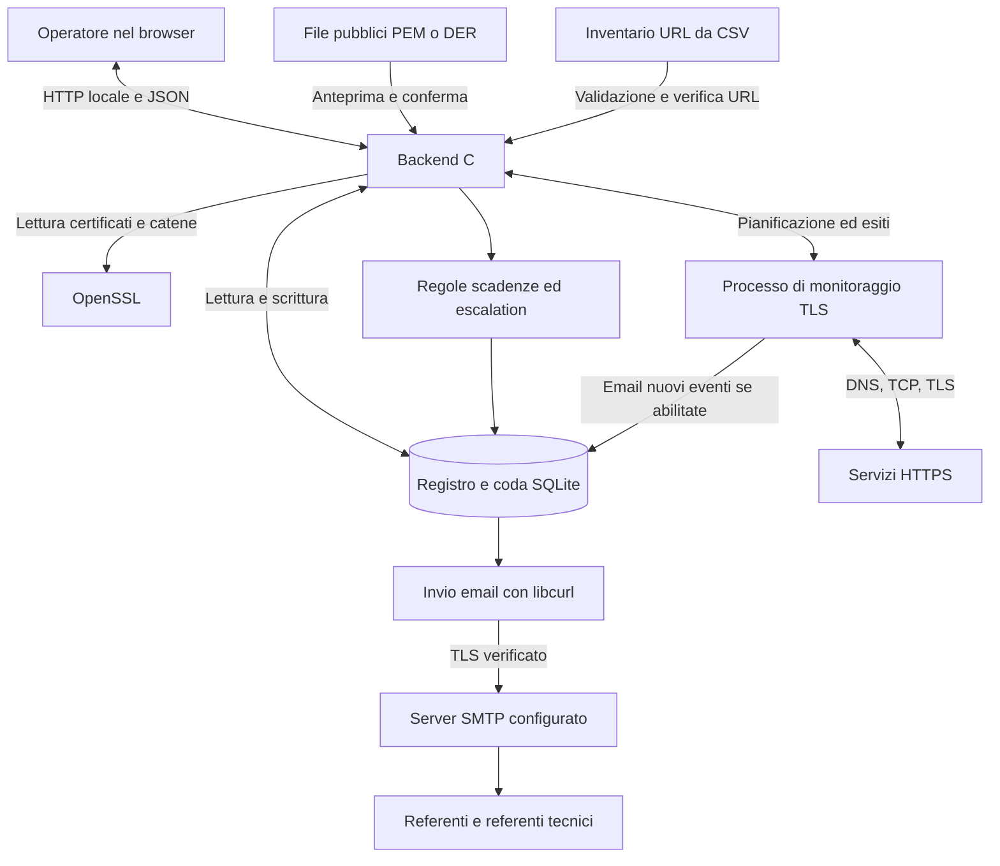
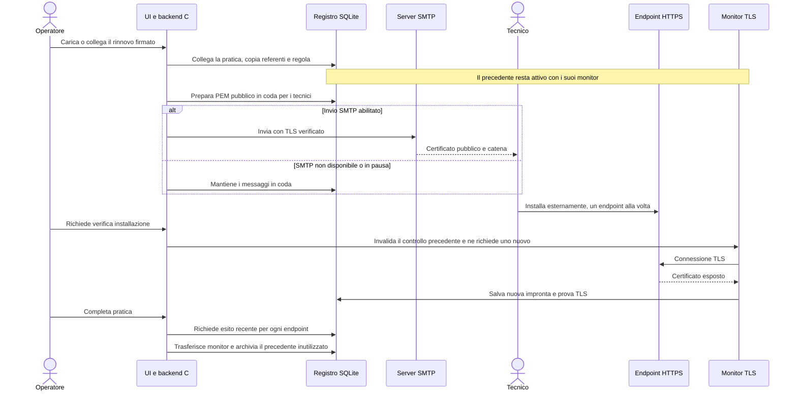

# Workflow di Certificate Manager

[Panoramica del progetto](../README.md) · [Guida italiana](README.it.md) · [English version](WORKFLOW.md)

Certificate Manager segue i certificati pubblici dall’acquisizione al rinnovo, alla consegna e alla verifica dell’installazione. Per uno stesso CN possono restare validi più certificati: tra la firma del rinnovo e la sua installazione possono passare giorni. Ogni impronta SHA-256 identifica una voce distinta del registro.

La pagina **Workflow** (`/workflow`) presenta diagrammi dei componenti, del ciclo operativo e del rinnovo nelle sei lingue dell’interfaccia. Le nove pagine comprendono anche **Rubrica** (`/rubrica`) per persone e gruppi condivisi. L’eseguibile continua a chiamarsi `certificati`; vedi [installazione e Docker Compose](README.it.md#installazione-e-avvio).

## Come dialogano i componenti



Il browser invia richieste e aggiorna lo stato salvato ogni 30 secondi. Il backend gestisce validazione, pianificazione e persistenza in SQLite. Le operazioni di rete dei monitor avvengono in un processo separato, così un servizio TLS lento non occupa il gestore delle richieste web. Chiudere il browser lascia attivi i controlli del backend; un caricamento CSV richiede invece che la scheda resti aperta.

| Parte | Responsabilità | Sorgente |
| --- | --- | --- |
| Interfaccia web | Nove pagine, filtri, caricamento guidato da file e CSV, rubrica e avanzamento della distribuzione. | [`web/app.js`](../web/app.js), [`web/i18n.js`](../web/i18n.js) |
| Server HTTP | Pagine e API con controlli Host, Origin e token CSRF. | [`src/server.c`](../src/server.c) |
| Certificati e catene | Lettura X.509, importazione del materiale pubblico e ricostruzione delle CA disponibili. | [`src/app.c`](../src/app.c), [`src/certificate.c`](../src/certificate.c), [`src/chain.c`](../src/chain.c) |
| Ciclo del rinnovo | Collegamenti fra certificati sovrapposti, pianificazione, prove per endpoint e condizioni di chiusura. | [`src/lifecycle.c`](../src/lifecycle.c) |
| Rubrica e regole | Persone, gruppi, assegnazioni riutilizzabili, promemoria e anteprime senza modificare il registro. | [`src/workspace.c`](../src/workspace.c) |
| Registro | Schema v5: certificati pubblici, piani, referenti, promemoria, eventi dei monitor, prove di installazione e coda. | [`src/store.c`](../src/store.c) |
| Verifiche degli endpoint | Recupero dei certificati e controlli di raggiungibilità, fiducia, nome, date e impronte approvate. | [`src/remote.c`](../src/remote.c), [`src/remote_service.c`](../src/remote_service.c), [`src/monitor.c`](../src/monitor.c) |
| Email | Messaggi per destinatario, deduplicazione degli eventi, tentativi e configurazione SMTP. | [`src/delivery.c`](../src/delivery.c), [`src/smtp_settings.c`](../src/smtp_settings.c) |

## 1. Esaminare, acquisire e registrare i certificati

**File di certificati.** Seleziona file PEM/DER o bundle PEM in **Importa certificati**. Prima di salvare, consulta CN, SAN, emittente, date di validità, impronta, Root CA e intermedie disponibili, duplicati e possibili predecessori. Gli avvisi sulla catena indicano l’emittente mancante e rimandano all’importazione per aggiungere i file CA disponibili. Non vengono recuperate CA automaticamente e caricare una Root CA non la rende fidata per le verifiche di rete.

L’anteprima usa un database temporaneo e non cambia il registro. Conferma l’importazione ordinaria oppure un collegamento di rinnovo proposto. Il candidato deve avere le stesse identità DNS/IP e una scadenza precedente; il CN viene usato quando mancano identità DNS/IP nei SAN. La sola presenza dello stesso CN non unisce automaticamente due voci. I duplicati di impronta conservano referenti e storico esistenti.

**Endpoint online.** Inserisci un URL HTTPS o un hostname risolvibile, eventualmente con porta. Per un CN wildcard serve un nome concreto. Il backend risolve DNS, apre TCP, negozia TLS con SNI dove applicabile e recupera la catena pubblica. Riporta separatamente fiducia, nome e validità; non richiede una pagina HTTP. Consulta o scarica il risultato, poi scegli esplicitamente di importarlo. Le acquisizioni temporanee durano fino a 10 minuti e ne restano disponibili al massimo otto. L’importazione online predispone un monitor a 15 minuti quando ammesso; quella da file non crea monitor.

**Inventario CSV.** Carica un file CSV fino a 1 MiB oppure incolla il testo, con al massimo 100 righe di dati. `url` è obbligatoria; le colonne facoltative sono `business_name`, `business_email`, `technical_name` e `technical_email`:

```csv
url,business_name,business_email,technical_name,technical_email
https://servizio.example.test,Responsabile,referente@example.test,Operazioni,tecnico@example.test
```

Separa più nomi e indirizzi nella stessa cella con punto e virgola, mantenendo lo stesso ordine. Valida, verifica gli URL, consulta gli esiti e avvia l’importazione. La scheda elabora le righe una alla volta, ripete ogni acquisizione prima di importare e blocca cambiamenti inattesi dell’impronta. Il certificato può restare consultabile per diagnosi anche se la verifica TLS è fallita; l’esito continua a segnalare il problema. L’importazione unisce i referenti per ruolo ed email. Ogni riga ha il proprio esito: un errore successivo non annulla le importazioni già riuscite. Correggi il problema e riprova; lascia aperta la scheda oppure interrompi il ciclo con l’apposito comando.

## 2. Assegnare le persone e cercare i certificati

| Ruolo | Riceve | Responsabilità |
| --- | --- | --- |
| Referente | Promemoria email alle soglie configurate. | Coordinare il rinnovo con CA e tecnici. |
| Referente tecnico | Nuovo certificato pubblico firmato e catena disponibile in allegato PEM. | Installare il rinnovo esternamente e richiedere la verifica. |
| Destinatario escalation | Email dopo il ritardo configurato dal primo promemoria registrato. | Sollecitare il completamento mentre il certificato resta attivo. |
| Destinatario avvisi monitor | Email dei nuovi eventi di anomalia e ripristino, se abilitate per il monitor. | Esaminare il servizio e l’esito del certificato. |

Una persona può avere entrambi i ruoli sul certificato. **Rubrica** centralizza persone e gruppi: assegnali a più certificati e propaga le modifiche a indirizzi email e membri attraverso le assegnazioni. Le origini dei gruppi vengono conservate nei rinnovi. La rimozione di un destinatario cancella i relativi messaggi in attesa/non riusciti, conservando lo storico degli invii conclusi. Per recapitare la coda serve un trasporto SMTP abilitato.

I filtri del registro combinano testo, validità temporale, referente, referente tecnico, Root CA, CA intermedia e scadenza entro una soglia con logica **AND**. Le soglie di ricerca 45/30/15/2 giorni includono soltanto certificati già validi che scadono entro la durata scelta e restano indipendenti dalle soglie personalizzate dei promemoria. `notBefore` X.509 indica l’inizio della validità, non necessariamente la firma; la sola validità nel tempo non dimostra fiducia né installazione.

## 3. Pianificare le date ed eseguire i controlli periodici

La pratica registra data della richiesta, rinnovo previsto, installazione prevista, responsabile e note. Sono date operative: non sostituiscono mai `notBefore` e `notAfter` del certificato. Aiutano a organizzare il lavoro; modificarle non richiede l’emissione alla CA e non distribuisce un certificato.

| Flusso | Frequenza | Risultato |
| --- | --- | --- |
| Regole di scadenza | All’avvio e ogni 60 secondi in `serve`. | Promemoria alle soglie raggiunte e messaggi in coda per i referenti. |
| Escalation | Nei controlli di scadenza, dopo il ritardo dal primo promemoria registrato. | Una escalation per certificato attivo e destinatario. |
| Monitor degli endpoint | Quando ciascun monitor attivo è dovuto; predefinita 15 minuti, configurabile da 1 a 1440 minuti. | Ultimo esito di rete/TLS/impronta, eventi di anomalia e ripristino deduplicati, email facoltative. |
| Elaborazione email | All’avvio e ogni 60 secondi, oppure con l’azione sulla coda. | Tentativi sui messaggi idonei quando SMTP è configurato e abilitato. |

Le soglie predefinite sono 45, 30, 15, 2 e 0 giorni. Per certificato puoi scegliere soglie distinte da **0 a 3650 giorni**, includendo `0`, oppure sospendere i promemoria. Le durate sono esatte, di 24 ore: con le impostazioni predefinite, un primo controllo a 10 giorni dalla scadenza registra i 15 giorni e salta i superati 45/30. Lo storico evita ripetizioni dopo il riavvio; i vecchi messaggi in attesa lasciano posto alla soglia più urgente.

L’escalation facoltativa usa **da 0 a 365 giorni dal primo promemoria registrato**, non dal caricamento o da una data pianificata. La firma di un rinnovo non interrompe promemoria ed escalation del precedente finché resta attivo.

I monitor distinguono irraggiungibilità, errore TLS, certificato cambiato e verifica fallita. Gli errori identici ripetuti sono deduplicati; il ripristino viene registrato dopo un’anomalia. L’opzione email per monitor prepara i nuovi eventi di anomalia e ripristino per i destinatari scelti. Inizialmente è disabilitata e attivarla non reinvia gli eventi storici. Segnare un evento come letto non modifica le attese né approva un certificato.

Durante un rinnovo collegato vengono riconosciuti il precedente e i rinnovi validi esplicitamente approvati nelle fasi firmato, consegnato o installazione. **Fiducia, nome e validità TLS restano obbligatori.** Un’impronta estranea è comunque inattesa; il monitor non importa né approva automaticamente certificati diversi.

Ogni attività periodica richiede un processo attivo. `serve` offre l’interfaccia; `watch` esegue promemoria, invii e monitor senza HTTP. Il suo intervallo regola promemoria e invii, mentre i monitor mantengono il proprio. `check` elabora una volta promemoria e coda. Le notifiche desktop richiedono inoltre una pagina aperta e il consenso del browser.

## 4. Preparare il rinnovo firmato e verificare l’installazione



Puoi aprire la pratica prima dell’emissione. Le fasi sono **Da richiedere → In attesa della CA → Firmato → Consegnato → In installazione → Verificato**, con l’esito separato **Ritirato** per il ritiro manuale. Cambiare una fase descrittiva non emette certificati, non invia email e non prova l’installazione.

Ottieni dalla CA il rinnovo firmato. Carica un certificato finale con le eventuali CA dall’azione di rinnovo del precedente, accetta un candidato nell’anteprima o collega una voce compatibile già presente. Il rinnovo deve essere già valido, avere scadenza successiva e mantenere le stesse identità DNS/IP; in assenza di SAN DNS/IP viene usato il CN. Voci CA e predecessori già archiviati sono respinti.

Il collegamento crea o riusa una pratica aperta senza rinnovo, copia referenti, origini dei gruppi ed eventuale regola promemoria e prepara gli allegati PEM per i tecnici. **Non archivia il precedente, non cancella i suoi promemoria e non sposta i monitor.** Riesce anche senza tecnici; puoi aggiungerli e preparare i messaggi in seguito. Emissione, firma e installazione effettiva rimangono esterne al programma.

| Voce nel registro | Validità X.509 | Stato operativo nella transizione |
| --- | --- | --- |
| Precedente | Può essere ancora valido | In uso fino al ritiro. |
| Nuovo firmato | Valido | Pronto prima dell’installazione. |
| Nuovo osservato durante la distribuzione | Valido | In distribuzione mentre la pratica resta aperta. |
| Precedente archiviato | Può essere ancora valido | Ritirato dopo chiusura o ritiro esplicito. |

Più rinnovi approvati possono coesistere per lo stesso CN, ognuno con impronta e collegamento distinti. I servizi possono essere aggiornati in giorni diversi. Il monitor ordinario può riconoscere un rinnovo approvato senza dichiarare verificata la pratica.

Dopo l’installazione richiedi la verifica per un endpoint o tutti. La richiesta invalida i controlli partiti prima; i servizi in pausa devono essere riattivati. **La chiusura richiede che ogni endpoint associato esponga l’impronta del rinnovo di quella pratica e superi le verifiche TLS dopo la richiesta. Sia la richiesta sia l’esito positivo devono risalire agli ultimi 15 minuti.** Un’osservazione automatica precedente, una prova vecchia o un errore TLS non bastano. Ripeti il controllo quando la prova non è più recente.

La chiusura trasferisce atomicamente i monitor verificati al nuovo certificato. Archivia il precedente solo se non conserva altre associazioni, interrompe i suoi promemoria futuri e rimuove i suoi messaggi in attesa/non riusciti. Eventuali URL duplicati già associati al nuovo certificato devono essere risolti prima della chiusura.

Con **zero endpoint** il programma non può dimostrare l’installazione. Il ritiro manuale richiede responsabile, nota esplicativa e nessun monitor ancora associato al precedente, inclusi quelli in pausa. L’esito è **Ritirato**, mai **Verificato**. Anche gli archivi migrati restano ritiri storici, senza inventare prove di distribuzione.

## 5. Controllare e inviare le email

**Coda email** contiene promemoria di scadenza, escalation, distribuzione di certificati pubblici e avvisi dei monitor abilitati. Configura host, porta, mittente, sicurezza ed eventuali credenziali. **Verifica connessione** prova TLS e autenticazione del modulo senza salvare né inviare email. Abilita l’invio quando vuoi procedere; altrimenti consulta e scarica i messaggi `.eml`.

Gli stati sono **In attesa → Invio in corso → Inviata**, oppure **Non riuscita**. Gli errori vengono ritentati con attese crescenti, fino a cinque tentativi automatici; il reinserimento manuale azzera il conteggio. “Inviata” significa accettazione SMTP, non consegna nella casella. Un’interruzione dopo l’accettazione può causare duplicati.

SMTP usa STARTTLS obbligatorio o TLS implicito con verifica del certificato e del nome. La password è cifrata con la chiave locale `<archivio>.smtp.key`: proteggi e conserva nei backup sia questa sia SQLite. Vedi [configurazione SMTP](README.it.md#coda-email-e-configurazione-smtp) e [sicurezza](../SECURITY.md). Il database non contiene chiavi private TLS.

## Esempio: due servizi aggiornati in giorni diversi

1. Importa il certificato, assegna responsabile e gruppo operativo e configura due monitor. Se serve, abilita gli avvisi email dei monitor.
2. Alla soglia configurata viene preparato un promemoria. Apri una pratica con date operative ed eventuale destinatario di escalation.
3. Ricevi e collega il rinnovo firmato. Entrambe le voci restano valide e visibili. Le email PEM per i tecnici entrano in coda; monitor e promemoria del precedente restano attivi.
4. Lunedì installa il rinnovo sul primo servizio. Il monitor riconosce l’impronta approvata, mentre il secondo servizio usa ancora il precedente valido. La pratica resta aperta.
5. Mercoledì installa sul secondo servizio, richiedi una nuova verifica di tutti gli endpoint e consulta entrambi gli esiti.
6. Completa entro 15 minuti dai controlli richiesti e riusciti. I monitor passano al nuovo certificato, il precedente entra nello storico e i suoi promemoria cessano. SMTP può restare in pausa durante le prove: i messaggi sono consultabili senza inviarli.
