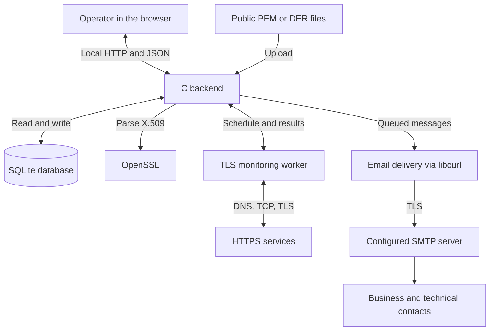
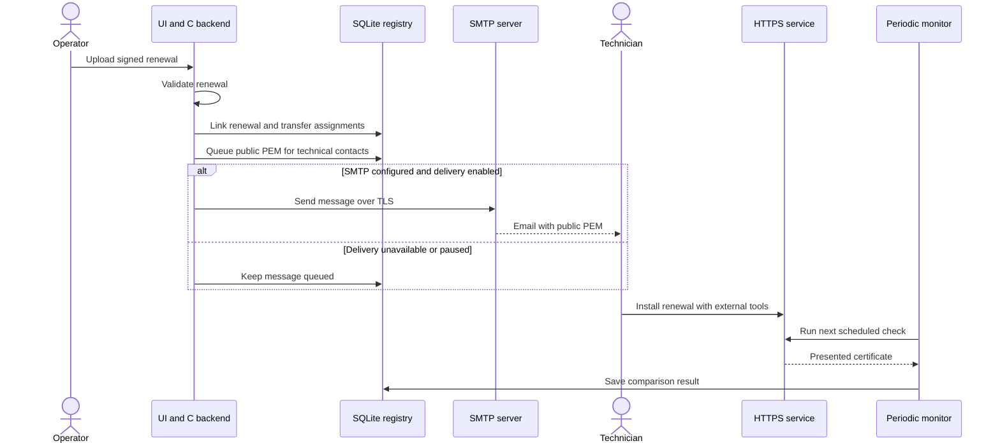

# Certificate Manager workflow

[Project overview](../README.md) · [Spiegazione in italiano](WORKFLOW.it.md)

Certificate Manager follows a certificate from acquisition to renewal and checks that monitored services present the expected certificate. The CA supplies the signed renewal; the application records it and distributes its public material; technical contacts install it on the service.

## How the components communicate

The browser provides the seven pages and calls the backend on `127.0.0.1`. The backend owns validation, certificate operations, scheduling and persistence. Browser refreshes retrieve saved state; closing the browser does not stop backend checks. Monitoring network acquisition runs in a separate process so a slow TLS peer does not occupy the web request handler.

| Part | Responsibility | Source |
| --- | --- | --- |
| Web interface | Forms, registry filters, results and language selection; refreshes state every 30 seconds. | [`web/app.js`](../web/app.js), [`web/i18n.js`](../web/i18n.js) |
| HTTP server | Serves pages and API requests; validates Host, Origin and CSRF tokens where required. | [`src/server.c`](../src/server.c) |
| Certificate operations | Import, expiry checks, contact changes and renewal. OpenSSL extracts X.509 data and reconstructs the available chain. | [`src/app.c`](../src/app.c), [`src/certificate.c`](../src/certificate.c), [`src/chain.c`](../src/chain.c) |
| Registry | Persists public certificates, metadata, assignments, reminders, monitor events and outbox state. | [`src/store.c`](../src/store.c) |
| Endpoint checks and monitoring | Retrieves live certificates, evaluates TLS results and compares fingerprints with the registry. | [`src/remote.c`](../src/remote.c), [`src/remote_service.c`](../src/remote_service.c), [`src/monitor.c`](../src/monitor.c) |
| Email delivery | Prepares recipient-specific messages, processes retries and uses saved SMTP settings. | [`src/delivery.c`](../src/delivery.c), [`src/smtp_settings.c`](../src/smtp_settings.c) |

## 1. Acquire and register a certificate

There are two entry points:

- **Import certificates:** upload public PEM/DER certificates, including a PEM bundle with the leaf and CA certificates. The backend extracts CN, SANs, issuer, validity dates, serial number and SHA-256 fingerprint, then saves the import transactionally. The fingerprint identifies duplicates, preserving existing contacts and history.
- **Verify endpoint:** enter an HTTPS URL or a resolvable hostname, optionally with a port. A wildcard CN requires a concrete hostname. The backend resolves DNS, opens TCP and negotiates TLS with SNI where applicable. It retrieves the presented public chain and separately reports trust, hostname and validity results. No HTTP page is requested.

An online check first produces a temporary result for inspection or download; adding it to the registry requires an explicit action. The result stays in memory for up to 10 minutes, with at most eight acquisitions retained. Download and import use that same acquisition.

Importing from the online result prepares a 15-minute monitor for that endpoint when eligible and not already configured. Importing a file does not create a monitor: add service addresses manually. CA names depend on the certificates available for chain reconstruction; importing a Root CA does not make it trusted by the network checks.

## 2. Assign contacts and find certificates

In a certificate's details, save one or more people for each required role:

| Role | Receives | Next action |
| --- | --- | --- |
| Business contact | Expiry reminder emails at the reached thresholds. | Coordinate renewal with the CA and technical team. |
| Technical contact | The renewed signed public certificate and available chain as a PEM attachment. | Install the renewal on the service and check the result. |

A person can hold both roles. Email delivery requires a configured, enabled SMTP transport; recording contacts alone does not send a message.

The registry combines text search, status, business contact, technical contact, Root CA, intermediate CA and expiry-within filters using **AND**. The 45/30/15/2-day filters include only certificates that are already valid and expire within the selected duration. Dates display X.509 `notBefore` and `notAfter`; time validity alone does not establish trust.

## 3. Check expiry and monitor services

These are separate background flows:

| Flow | When it runs | Result |
| --- | --- | --- |
| Expiry reminders | At server startup and every 60 seconds in `serve`. | Saved reminders and email queue entries for business contacts at 45, 30, 15, 2 days and expiry. |
| Endpoint monitoring | At each enabled monitor's due time; default 15 minutes, configurable from 1 to 1440 minutes. | Saved status, observed fingerprint and events for unreachable services, TLS errors, changed certificates, verification problems and recovery. |
| Email processing | At server startup and every 60 seconds, or from the process-queue action. | Attempts eligible queued messages only when SMTP delivery is configured and enabled. |

Thresholds use exact 24-hour durations. If the first expiry check occurs with 10 days remaining, it records the 15-day reminder, skipping the obsolete 45- and 30-day reminders. Persistent history prevents repeated threshold notifications; queued reminders that have become obsolete are removed in favor of the current threshold.

Monitoring compares the live leaf's **SHA-256 fingerprint** with that of the associated registry certificate. Repeated identical faults do not create another event at every check; a new observed fingerprint or a recovery can create an event. Marking an event as read does not change the monitor or accept a new certificate.

**Monitor events appear in the interface and optional desktop notifications; they do not generate email.** A changed certificate is not imported or accepted as a renewal automatically. Inspect it and choose whether to register it through the renewal process.

All periodic work needs a running process. `serve` also provides the web interface; `watch` runs reminders, delivery and configured monitors without the HTTP server. In `watch`, the command's interval controls reminders and delivery, while monitors retain their saved intervals. `check` processes reminders and delivery once. Desktop notifications additionally require the browser page to remain open and permission to display them.

## 4. Record a renewal and distribute it

Obtain the signed renewal from your CA first. In the **old certificate's details**, use the renewal upload action. The file must contain one leaf certificate, optionally with CA certificates. The leaf must already be valid, expire later than the predecessor and preserve its DNS/IP identities; the CN is used as a fallback when no DNS/IP SAN identities are present.

The backend records the renewal atomically: it links and archives the old entry, transfers contacts and monitors to the new entry, removes the old certificate's pending/failed messages and prepares a PEM distribution message for each technical contact. Without technical contacts, renewal still succeeds; add them later and use the manual preparation action. Ordinary import creates a registry entry without establishing the renewal relationship.

The monitor now expects the **new** fingerprint and starts again with a pending status. Until the technical contact installs the certificate, the service can still present the old one and correctly trigger a difference alert. If a fault has been observed after renewal, the next successful matching check records recovery; if the first check already matches, it saves a regular result without a recovery event. Certificate Manager does not issue, sign or install certificates, and its database contains no TLS private keys.

## 5. Review and deliver email

In **Email queue**, configure the SMTP host, port, sender, security mode and optional credentials. **Test connection** checks TLS and authentication for the current form without saving or sending an email. Saving with delivery enabled permits the queue processor to send pending messages; leaving delivery disabled keeps them for review and `.eml` download.

Messages move through **Pending → Sending → Sent**, or **Failed** when an attempt fails. Failed deliveries are retried with increasing delays, up to five automatic attempts; manual requeue resets the attempt count. “Sent” means SMTP acceptance, not confirmed inbox delivery. A process interruption after SMTP acceptance can cause a duplicate.

SMTP uses mandatory STARTTLS or implicit TLS with certificate and hostname verification. The password is encrypted in SQLite using a local `<database>.smtp.key` file. Back up and protect both files. See the [SMTP configuration](../README.md#smtp-configuration) and [security model](../SECURITY.md) for details.

## Operational example

1. Verify `https://service.example.test`, inspect its public certificate, explicitly import it and save the business and technical contacts. The online import prepares a 15-minute monitor.
2. At 30 days remaining, the expiry check records the reached threshold and queues messages for business contacts. They remain pending while SMTP delivery is disabled.
3. Obtain the CA-signed renewal and upload it through the old entry's renewal action. The new entry inherits contacts and monitors; technical contacts' messages contain the public certificate and available chain.
4. Enable the configured SMTP transport when ready to deliver. The technical contact receives the material and installs it using the service's deployment procedure.
5. At the next endpoint check, monitoring compares the installed certificate with the renewed registry entry and records the result. If deployment has not happened or another certificate is exposed, the interface shows the discrepancy.

`service.example.test` is an example name; use a real resolvable service address for an actual check.
