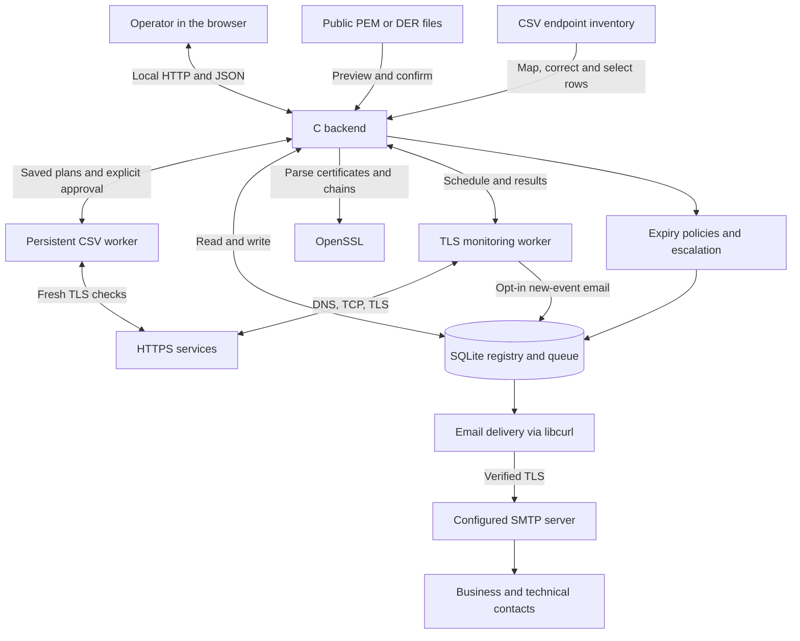
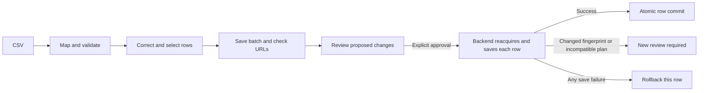

# Certificate Manager workflow

[Project overview](../README.md) · [Spiegazione in italiano](WORKFLOW.it.md)

Certificate Manager follows public certificates from acquisition through renewal, delivery and verified deployment. Several certificates for the same CN may remain valid at once: the CA's signed replacement can be ready days before technicians finish installing it. Each SHA-256 fingerprint identifies a separate registry record.

The **Workflow** page (`/workflow`) provides local component, lifecycle and renewal diagrams in all six interface languages. The ten pages also include **Directory** (`/rubrica`) for shared people and groups and **Renewals** (`/rinnovi`) for the operational agenda. The [20-improvement guide](WORKFLOW-IMPROVEMENTS.it.md) lists the implemented flows in Italian. The executable remains `certificati`; see [build and Docker Compose instructions](../README.md#build-and-run).

## How the components communicate



The browser sends requests and refreshes saved state every 30 seconds. The backend owns validation, scheduling and SQLite persistence. Monitoring network operations run in a separate worker so slow TLS peers do not occupy the HTTP request handler. Closing the browser leaves backend checks and persistent CSV batches running. Both require `serve` or `watch` to stay active; saved batches can resume after a process restart. Planning a batch does not authorize import.

| Part | Responsibility | Source |
| --- | --- | --- |
| Web interface | Ten pages, row mapping/corrections/reports, directory, renewal agenda, checklist and incident handling. | [`web/app.js`](../web/app.js), [`web/extensions.js`](../web/extensions.js), [`web/operations-ui.js`](../web/operations-ui.js), [`web/incidents-ui.js`](../web/incidents-ui.js) |
| HTTP server | Pages and API requests with Host, Origin and CSRF checks. | [`src/server.c`](../src/server.c) |
| Certificates and chains | Parse X.509 data, import public material and reconstruct available CA links. | [`src/app.c`](../src/app.c), [`src/certificate.c`](../src/certificate.c), [`src/chain.c`](../src/chain.c) |
| Renewal lifecycle | Link overlapping certificates, plan work, record endpoint evidence and guard completion. | [`src/lifecycle.c`](../src/lifecycle.c) |
| Directory and policies | People, groups, reusable assignments, reminder settings and read-only import previews. | [`src/workspace.c`](../src/workspace.c) |
| CSV worker | Persist reviewed plans and approval; commit each row atomically and resume saved work. | [`src/inventory.c`](../src/inventory.c) |
| Workflow operations | Compare certificates, preview directory impact and policies, apply templates, capture closure reports. | [`src/operations.c`](../src/operations.c), [`src/workflow_support.c`](../src/workflow_support.c) |
| Incidents | Track handling, maintenance windows and consecutive reachability failures. | [`src/incident.c`](../src/incident.c) |
| Registry | Schema v6: public certificates, plans, contacts, reminders, monitor events, deployment evidence and outbox. | [`src/store.c`](../src/store.c) |
| Endpoint checks | Acquire live certificates and verify reachability, trust, hostname, dates and approved fingerprints. | [`src/remote.c`](../src/remote.c), [`src/remote_service.c`](../src/remote_service.c), [`src/monitor.c`](../src/monitor.c) |
| Email | Queue recipient-specific messages, deduplicate events, retry and use saved SMTP settings. | [`src/delivery.c`](../src/delivery.c), [`src/smtp_settings.c`](../src/smtp_settings.c) |

## 1. Preview, acquire and register certificates

**Certificate files.** Select PEM/DER files or PEM bundles in **Import certificates**. Review CN, SANs, issuer, validity dates, fingerprint, available Root/intermediate CAs, duplicates and possible predecessors before saving. Chain warnings identify the missing issuer information and lead back to import for adding available CA files. CA certificates are not retrieved automatically, and importing a Root CA does not make it trusted for network checks.

The preview uses a temporary database and does not modify the registry. Confirm an ordinary import or a proposed renewal relationship. A candidate requires matching DNS/IP identities and a later replacement expiry; the CN is a fallback when DNS/IP SANs are absent. Sharing a CN alone does not automatically merge records. Fingerprint duplicates retain existing contacts and history.

**Live endpoints.** Enter an HTTPS URL or resolvable hostname, optionally with a port. Use a concrete hostname for a wildcard CN. The backend resolves DNS, opens TCP, negotiates TLS with SNI where applicable and retrieves the public chain. It separately reports trust, hostname and validity checks; no HTTP page is requested. Inspect or download the result, then explicitly import it. Temporary snapshots last up to 10 minutes, with at most eight retained. Online import prepares a 15-minute monitor when eligible; file import does not create a monitor.

**CSV inventory.** Upload a CSV file up to 1 MiB or paste its contents. There may be at most 100 data rows. The required column is `url`; optional columns are `business_name`, `business_email`, `technical_name` and `technical_email`:

```csv
url,business_name,business_email,technical_name,technical_email
https://service.example.test,Owner,owner@example.test,Operations,ops@example.test
```

Separate multiple names/emails inside a contact cell with semicolons, keeping the same order. Select comma, semicolon or tab as the file separator, and explicitly map unfamiliar column names or ignore unused columns. The preview preserves the source line number and reports errors by field. Correct cells through the row editor, select valid rows and download corrected CSV or outcome reports.



**Check URLs** saves selected input as a durable batch and prepares the plan in a backend worker. Inspect the new/existing certificate, CA information, validity, monitor and contact changes. A different name for an existing email is a conflict: explicitly keep the saved name or update it across its shared assignments. Approval is tied to the reviewed plan; mixed batches require explicit selection of the ready rows.

At import the worker reacquires the public certificate, verifies TLS and the reviewed fingerprint, then rechecks registry changes. It permits compatible additive changes from earlier rows; incompatible changes require another review. Each row saves the certificate chain, monitor, people, role assignments, audit and idempotency receipt together. A failure rolls that row back, preserving earlier successful rows. There is no email delivery from the CSV worker.

The saved-batch list offers inspection, pause, replan and reports, including only rows needing correction. It survives closing the browser and restarting the application; processing needs `serve` or `watch` running. A preview without approval never becomes an automatic import.

## 2. Assign people and find certificates

| Role | Receives | Responsibility |
| --- | --- | --- |
| Business contact | Expiry reminder emails at the configured thresholds. | Coordinate the renewal with the CA and technicians. |
| Technical contact | The signed public replacement and available chain as a PEM attachment. | Install the renewal externally and request deployment verification. |
| Escalation recipient | An escalation email after the configured delay from the first recorded reminder. | Follow up while the certificate remains active. |
| Monitor alert recipient | New anomaly and recovery emails when enabled for that monitor. | Investigate the service and certificate result. |

A person may have both certificate contact roles. **Directory** centralizes people and groups; assign them to several certificates, then propagate email or membership changes through those assignments. Before a shared person/group change, review affected certificates, pending messages and related monitor recipients. For edits the review includes proposed names, email and memberships and the resulting certificate impact. It is not an authenticated approval. Group origins are retained across renewal. Removing a recipient cancels relevant pending/failed messages while preserving sent history. An enabled SMTP transport is required to deliver queued messages.

Registry filters combine text, time-validity status, business contact, technical contact, Root CA, intermediate CA and expiry-within using **AND**. The 45/30/15/2-day search filters include only already-valid certificates expiring within the chosen duration. They remain independent of customizable reminder thresholds. X.509 `notBefore` is the start of validity, not necessarily the signing time; time validity does not establish trust or prove installation.

## 3. Plan dates and run periodic checks

The **Renewals** agenda lists all cases, filters status/responsible person/overdue work, and links to certificate details. A case selector exposes all open and completed cases for the selected certificate. A renewal case stores the request date, planned renewal date, planned installation date, responsible person and notes. These are operational dates and never replace X.509 `notBefore` or `notAfter`. They help organize work; editing a planned date does not request issuance from the CA or deploy a certificate.

| Flow | Schedule | Result |
| --- | --- | --- |
| Expiry policies | At startup and every 60 seconds in `serve`. | Saved reached-threshold reminders and queued emails to business contacts. |
| Escalation | During expiry checks, after the configured delay from the first recorded reminder. | One escalation per active certificate and destination. |
| Endpoint monitors | Each enabled monitor's due time; default 15 minutes, configurable from 1 to 1440 minutes. | Latest reachability/TLS/fingerprint result, deduplicated anomaly and recovery events, optional alert emails. |
| Email processing | At startup and every 60 seconds, or through process-queue. | Attempts eligible messages when SMTP is configured and enabled. |

Defaults are 45, 30, 15, 2 and 0 days. Per-certificate policies can use distinct thresholds from **0 to 3650 days**, including `0`, or pause reminders. Thresholds use exact 24-hour durations: with the defaults, a first check at 10 days remaining records 15 days and skips obsolete 45/30-day reminders. History prevents repeating reached thresholds after restart; obsolete queued reminder messages give way to the more urgent threshold.

Optional escalation uses **0 to 365 days from the first recorded reminder**, not from certificate upload or a planned date. Signing a replacement does not stop the predecessor's reminders or escalation while it remains active.

Use **Simulate reminders** to inspect the draft rule’s calendar, recorded/superseded thresholds, recipients and escalation without writing notifications or email. Save reusable templates on **Reminders**, select certificates and exceptions, then approve the before/after plan. Changes to the template or affected rules invalidate its confirmation.

Monitors distinguish unreachable, TLS failure, changed certificate and verification failure. Repeated identical faults are deduplicated; recovery is recorded after a fault. An optional per-monitor email setting queues new anomaly and recovery events to selected recipients. It is disabled by default, and enabling it does not replay historical events. Marking an event read neither changes expectations nor approves a certificate.

A reachability threshold of **1–10 consecutive failures** delays anomaly email for DNS/TCP outages; default one. Observations remain visible immediately, while TLS errors and unexpected fingerprints do not wait for that threshold. Maintenance suppresses new anomaly/recovery email while retaining technical checks and events. At its end a fresh check is requested; a paused service must still be reactivated.

Claim an event with a responsible person, note, due date and open/investigating/resolved handling state. Administrative resolution does not alter the technical outcome. An unexpected fingerprint offers a link to fresh acquisition and comparison, followed by explicit import and a compatible renewal link if appropriate.

During a linked renewal, the monitor recognizes the predecessor and valid replacements explicitly approved by a signed, delivered or installing case. **TLS trust, hostname and validity checks remain mandatory.** An unrelated fingerprint is still unexpected. A changed certificate is never imported or approved automatically.

All periodic work needs a running process. `serve` provides the interface; `watch` runs reminders, delivery and configured monitors without HTTP. Its interval controls reminders and delivery; monitors retain their own intervals. `check` processes reminders and delivery once. Desktop notifications additionally need an open browser page and permission.

## 4. Stage a signed renewal and verify deployment

```mermaid
sequenceDiagram
    actor Operator
    participant App as UI and C backend
    participant DB as SQLite registry
    participant SMTP as SMTP server
    actor Technician
    participant Service as HTTPS endpoints
    participant Monitor as TLS monitor
    Operator->>App: Upload or link signed replacement
    App->>DB: Link case, copy contacts and policy
    Note over DB,Monitor: Previous record stays active; monitors stay associated
    App->>DB: Queue public PEM for technicians
    alt SMTP delivery enabled
        App->>SMTP: Send over verified TLS
        SMTP-->>Technician: Public certificate and chain
    else SMTP unavailable or paused
        App->>DB: Keep messages queued
    end
    Technician->>Service: Install externally, endpoint by endpoint
    Operator->>App: Request installation verification
    App->>Monitor: Invalidate earlier worker and request fresh check
    Monitor->>Service: TLS connection
    Service-->>Monitor: Presented certificate
    Monitor->>DB: Save new fingerprint and TLS evidence
    Operator->>App: Complete renewal case
    App->>DB: Require fresh success for every endpoint
    App->>DB: Transfer monitors; archive unused predecessor
```

Start the case before issuance if useful. The stages are **Requested → Awaiting CA → Signed → Delivered → Installing → Verified**, with a separate **Retired** outcome for manual retirement. Descriptive stage changes do not issue a certificate, send an email or prove deployment.

Use the comparison view before linking to inspect CN, SANs, issuer, Root/intermediate CAs, validity, fingerprints and key/signature algorithms. It reports whether identities and validity permit a renewal. Obtain the signed replacement from the CA. Upload one leaf certificate plus optional CA certificates through the predecessor's renewal action, accept a candidate in the import preview, or link a compatible existing record. The replacement must already be valid, expire later and preserve the same DNS/IP identities, falling back to CN when no DNS/IP SANs are present. CA entries and archived predecessors are rejected.

Linking creates or reuses an open case without a replacement, copies contacts, group assignment origins and any reminder policy, and queues public PEM messages for technical contacts. **It does not archive the predecessor, remove its reminders or move its monitors.** Without technical contacts, the link still succeeds; add them and prepare messages later. Issuance, signing and actual installation remain external operations.

| Certificate record | X.509 time validity | Operational state during transition |
| --- | --- | --- |
| Previous | May still be valid | In use until retired. |
| Signed replacement | Valid | Ready before installation. |
| Replacement observed during rollout | Valid | Deploying while the case remains open. |
| Archived previous record | May still be valid | Retired after completion or explicit retirement. |

Several approved replacements can coexist for the same CN; each record has its own fingerprint and relationship. Services can be updated on different days. A regular monitor can recognize an approved replacement without declaring the case verified.

After installing, request verification for an individual endpoint or all endpoints. The request invalidates workers that started earlier. Paused endpoints must be reactivated. **Completion requires every associated endpoint to present the case's replacement fingerprint with successful TLS verification after that request. Both the request and positive result must be within the last 15 minutes.** A previous automatic observation, an old success, or a TLS failure cannot close the case. Repeat the verification if evidence ages out.

The checklist presents the expected/observed fingerprint, latest check and every blocker per service: pause, missing/stale request or proof, failed TLS, association changes and duplicate targets. It uses the same backend function as completion. Refreshing the checklist reads evidence; request a new TLS verification separately when needed. The interface disables completion when displayed evidence ages beyond 900 seconds, and the server always rechecks.

Completion atomically transfers verified monitors to the replacement. It archives the predecessor only with no remaining monitor associations, ends its future reminders and removes pending/failed messages for that predecessor. Duplicate monitor targets already associated with the replacement must be resolved before completion.

With **zero endpoints**, the program cannot prove installation. Explicit manual retirement requires a responsible person, an explanatory note and no monitors still associated with the predecessor, including paused ones. The result is **Retired**, never **Verified**. Migrated archived history is likewise retained as historical retirement without inventing deployment evidence.

At verified completion or manual retirement, the same transaction captures a JSON snapshot **before** moving monitors or archiving. The downloadable report separates this closure evidence from current case data. Later observations do not replace the snapshot. Deleting the case can delete its report; this local history is not an authenticated or tamper-proof audit trail. **Workflow** exposes the latest 500 recorded operations, with details such as contact changes, case updates and SMTP outcomes. Audit starts with schema v6, without inventing earlier actions.

## 5. Review and deliver email

**Email queue** contains expiry reminders, escalation, signed public-certificate distribution and opt-in monitor alerts. Configure host, port, sender, security mode and optional credentials. **Test connection** checks TLS/authentication for the current draft without saving it or sending email. Enable delivery when ready; otherwise inspect or download queued `.eml` messages.

Each renewal case has a per-technical-recipient delivery panel showing state, attempt count and error, with `.eml` download and retry for failed messages. Refresh it after processing the queue.

Messages progress through **Pending → Sending → Sent**, or **Failed**. Failures retry with increasing delays up to five automatic attempts; manual requeue resets the counter. “Sent” means SMTP acceptance; it proves neither inbox delivery nor certificate installation. An interruption after acceptance can cause a duplicate.

SMTP uses mandatory STARTTLS or implicit TLS with certificate/hostname verification. The password is encrypted using a local `<database>.smtp.key`; back up and protect both it and SQLite. See [SMTP configuration](../README.md#smtp-configuration) and [security](../SECURITY.md). The database contains no TLS private keys.

## Example: two services updated on different days

1. Import a service certificate, assign the owner and operations group, and configure two endpoint monitors. Optionally enable monitor email alerts.
2. A reminder is queued at the configured threshold. Open a case with requested/planned dates and an escalation recipient if needed.
3. Receive and link the signed replacement. Both records remain valid and visible. Technicians' PEM messages are queued; the predecessor's monitors and expiry reminders remain active.
4. Install the replacement on the first service on Monday. Its monitor recognizes the approved fingerprint while the second service still uses the previous valid certificate. The case remains open.
5. Install on the second service on Wednesday, request fresh verification of all endpoints and inspect both results.
6. Complete within 15 minutes of successful requested checks. Monitors move to the replacement, the old record enters history, and its reminders stop. SMTP may remain paused throughout testing; queued messages can be reviewed without delivery.

## Upgrade and restore

Schema v6 adds durable CSV batches and receipts, policy templates, incident settings/claims, closure reports and local audit. Back up the stopped database **and** its `.smtp.key` sidecar before upgrading; preserve private storage and key mode `0600`. The application remains local without user authentication. A named responsible person is an operator-supplied field, not a verified identity.
